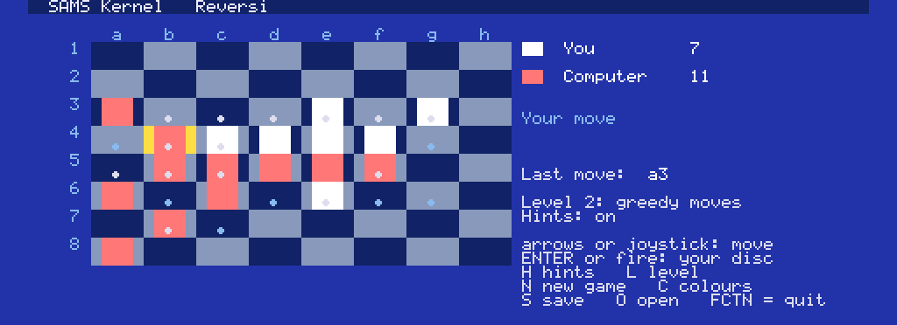

# SAMS Kernel: the programmer's guide

How to write an application for the TI-99/4A in TMS9900 assembly on the SAMS Kernel. The guide is a tutorial first (parts 1-3 get a program on the screen), then
a tour of each service (parts 4-11), then the practical matter of building and
testing (parts 12-13), and ends with a checklist of the mistakes that have already
cost someone a day (part 14). Look up a single routine in
[ROUTINES.md](ROUTINES.md); the machine's facts are in [HARDWARE.md](HARDWARE.md);
how the kernel works inside is in [ARCHITECTURE.md](ARCHITECTURE.md).

The kernel's source is the one place that is never out of date. Where this guide and a
header comment in `kernel/` disagree, the comment is right and this guide should be fixed.

## 0. What you get, what you need

**The machine the kernel assumes:** a TI-99/4A with an **F18A** (or PICO9918) video
card, a **SAMS** memory card of at least the size your application asks for (128 pages,
512K, by default), and a cartridge slot holding a **FinalGROM 99** (or any cartridge that
presents 8K banks selected by writes to `>6000 + 2n`: the "8" image format; js99er and
Classic99 load the same file). The loader refuses to start, with a plain message, if the
card, its size or the F18A is missing.

**What the kernel gives your program:**

| | |
| --- | --- |
| Screen | boots in 80 x 30 text (F18A "Text 80", a colour per character cell; 256 six-by-eight glyphs; 15 colour *roles* and five colour schemes; DMA row moves); `VMODE` sets **any F18A mode**: Text 80/40, Graphics I and II, Multicolor, enhanced colour, sprites, tile layer 2, the bitmap layer (part 5 and VIDEO-MODES.md) |
| Keyboard | 64-key buffer, auto-repeat, SHIFT / CTRL / FCTN / ALPHA LOCK chords decoded to one byte each |
| Memory | 7K of RAM that is always there (slot A), 8K of your code in the window at `>C000`, and up to 16M of SAMS pages you map into `>E000-FFFF`; a page pool to hand them out |
| Structure | a main loop that calls your module once a frame; up to dozens of 8K modules; `GOMOD` to switch, `MODCALL` to call into another module and come back |
| Files | open, read, write, close, delete through any DSR (disk controller, TIPI, ...) |
| Music | play a song from SAMS pages (a register-log player, stepped every frame), tone effects; songs compile from MIDI or a text score (MUSIC.md) |
| Safety | the loader's checks, a clean power-up state, a clean exit to the TI title screen |

**What you need on the PC** (the **[PC]** route): Python 3, and [xdt99](https://github.com/endlos99/xdt99)
(`xas99.py` is the assembler). Put xdt99 beside this directory (`../xdt99`), or set
`XAS99` to the path of `xas99.py`. A web browser with js99er.net for running; the
headless simulator in `tools/` for testing.

### What you need on the TI

**[TI]** The workbench cartridge image (`images/workbench8.bin`, on a FinalGROM 99 or in js99er) and its disk (`images/workbench.dsk`, in DSK1), on a TI with an F18A and a SAMS card. A PC is needed once, to make those two
(they are prebuilt in the distribution); after that you can edit, assemble and run on the TI alone. WORKBENCH.md is the manual.

**Two ways to work, marked throughout these documents.**

| Mark | Where | What you use |
| --- | --- | --- |
| **[PC]** | on a PC with Python 3 and [xdt99](https://github.com/endlos99/xdt99) | any editor; `skbuild.py` builds a cartridge image; the simulator, js99er or a real TI runs it; `skdisk.py`, `skmusic.py` and the tests help |
| **[TI]** | on the TI-99/4A itself (or js99er playing one), with the workbench cartridge and its disk | the workbench's editor, assembler and launcher: nothing else |
| **[PC or TI]** | either | the same either way: the assembly source and every kernel call |

A block is tagged when it belongs to one route only. Assembly source is **[PC or TI]** unless a note says otherwise (the **[TI]** route assembles one module of up to 4,096 bytes, at `>C000`: see the table below).
Shell commands are **[PC]**; key sequences like "N, type a name, ENTER" are **[TI]**.

| | **[PC]** | **[TI]** |
| --- | --- | --- |
| Write the source | any editor | the workbench editor (80 columns, up to 2,040 lines) |
| Assemble | xas99: the full dialect, user macros, large programs | the workbench's native assembler: xas99's dialect without user macros (`.defm`) or forward `EQU`; image up to 4,096 bytes; symbols up to 12 characters |
| Modules | as many as you like (`app.json`); `GOMOD` and `.callmod` between them | one module; the only switch is back to the workbench (`GOMOD PG_WB`) |
| Data in SAMS pages (`data`), music compiled at build (`from`), `PD_` equates | yes | no |
| Your own font and colour schemes (`databank.a99`) | yes | no |
| Every kernel routine (`PUTS`, `VMODE`, `FOPEN`, `FSEL`, `JOYGET`, `PINIT`, `SNDTONE` ...) | yes | yes (`MUPLAY` needs a song in SAMS pages, so it is **[PC]**) |
| Output | a cartridge image (`NAME8.bin`) for js99er, FinalGROM or a real TI | the program runs inside the workbench; no cartridge (a TI cannot write a FinalGROM) |
| Run | simulator (`sk.py run`), js99er, real machine | `R` in the workbench, at once |
| Test | Python against the simulator: key scripts in, screen and memory out; the kernel's own test groups | run it and look; the `DBG` routine and screen breadcrumbs; `docs/HARDWARE-CHECKLIST.md` |

## 1. Hello, kernel

**[PC]** Build and run the smallest example:

```
python3 tools/skbuild.py examples/hello
python3 tools/sim9900.py build/hello/hello8.bin --keys "<ALPHA>hello" --frames 200
```

**[TI]** The same program, on the TI: load `workbench8.bin` with `workbench.dsk` in DSK1, then press **N**, type `DSK1.HELLO/A99`, **ENTER** (TI file names have no dots: `hello.a99` is `HELLO/A99`),
**A** (the screen says "Assembled: 194 bytes at >C000"), **R** (the program runs: type, and FCTN = quits). **E** shows the source in the editor. To type a program in yourself: **N**, `DSK1.MINE/A99`, **ENTER**, **E**, type it,
**CTRL A** (saves and assembles), then **R**. (The anatomy below walks through `hello.a99`, line by line; WORKBENCH.md part 2a has a complete worked example, typed on the TI and built on the PC.)

The **[PC]** commands assemble the kernel, the loader and your module and writes
`build/hello/hello8.bin`, a cartridge image. The second runs it in the simulator and
prints the screen as text. To run it in js99er, load `hello8.bin` as a FinalGROM/cartridge
image with the F18A and a SAMS card (512K or more) switched on in its settings.

Start your own application with the scaffolder, which writes a working one-module
program:

```
python3 tools/newapp.py myapp --name "MY APP"
python3 tools/skbuild.py myapp
```

### Anatomy of `examples/hello/hello.a99`

```
       COPY "kernel.equ"      the kernel's symbols (routines, variables, equates)
       COPY "macros.a99"      .enter, .leave, .push, .pop, .callmod
```

Every module begins with these two lines. `kernel.equ` is written by the build when it
assembles the kernel: it holds the address of every kernel routine (`PUTS`, `KEYGET`,
...) and every equate (`COLS`, `RTEXT`, `APPRAM`, `KQUIT`, ...). Your module is
assembled separately, loaded into SAMS pages, and never linked to the kernel: these
symbols are the whole connection.

```
ATEXT  EQU  (RTEXT*16+RBG)*256        text on the page background
```

A cell's **attribute** is a byte: foreground colour *role* in the high nibble,
background role in the low (part 5). It is passed in the *high byte* of a register,
as every byte value in this kernel is, so the equate multiplies by 256.

```
       AORG >C000
       DATA INIT,TICK,REDRAW,0         the entry table
```

A module is assembled to run at `>C000` and starts with its **entry table**: four
words, the addresses of `INIT`, `TICK`, `REDRAW` and a reserved word (part 3).

```
INIT   .enter
       BL   @REDRAW
       .leave
       RT
```

`INIT` is called when the kernel switches to your module. `.enter` and `.leave` save and
restore the return address on the software stack: any routine that calls another needs
them (part 4).

```
TICK   .enter
       MOV  R0,R0
       JEQ  TK9                        no key
       CI   R0,KQUIT*256               FCTN = ?
       ...
       SETO @QUITF                     ask the kernel to quit
```

`TICK` is called **once every frame** (sixtieth of a second) with `R0` holding the next
key typed, in the high byte, or `0` for none. Setting `QUITF` non-zero asks the kernel to
quit to the TI title screen. A key's code is a byte: ASCII for printable keys, with
FCTN and CTRL chords in `>C0-FF` and `>80-BF` (part 6).

That is a whole program. Everything else in this guide is about doing more in `INIT`
and `TICK`.

## 2. The machine, in one page

```
CPU address space              SAMS page(s)        what lives there
>0000-1FFF  console ROM        (not mapped)
>2000-3FFF  SLOT A             >02-03, fixed       kernel + application variables, the stack
>4000-5FFF  DSRs, mapper regs  (not RAM)
>6000-7FFF  cartridge          (not mapped)        only the loader looks at it
>8300-83FF  scratchpad         (not mapped)        fast RAM: workspace, kernel hot variables
>8400-9FFF  I/O ports          (not RAM)
>A000-BFFF  THE KERNEL         >0A-0B, fixed       6.9K of 7.5K it may use
>C000-DFFF  SLOT C             your module (2 pages) the running module, 8K
>E000-FFFF  SLOT B             any 2 pages         your data: window >E000 and window >F000
```

- **Slot A** is where your *variables* live, always mapped: `APPRAM` (`>2300`) up to
  `APPTOP` (`>3F00`) is yours, 7,168 bytes; `MODRAM` (`>2200`, 256 bytes) is scratch for
  the running module and is not kept across a module switch. The stack is `>3F00-3FFF`.
- **Slot C** is where your *code* runs. Only one module is mapped at a time.
- **Slot B** is for *data* too big for slot A: you map one SAMS page at `>E000` and
  another at `>F000` as you need them (part 7).
- **VRAM** (16K, on the F18A): the screen's tables take `>0000-215F`; most of the rest
  is yours (part 5).

Register use, in one sentence: **R0-R9 are scratch, R10 is the stack pointer, R11 the
return address, R12 the CRU base, R13-R15 are best left alone.**

## 3. The anatomy of a module

A module is up to 8,192 bytes of code and constant data assembled at `>C000`. The
first four words:

| Word | Name | Called | R0 | R1 |
| --- | --- | --- | --- | --- |
| `>C000` | `INIT` | when the kernel switches to the module (boot, or `GOMOD`) | the page of the module before, 0 at boot | the argument `GOMOD` was given, 0 at boot |
| `>C002` | `TICK` | every frame | the next key code (high byte), or 0 | |
| `>C004` | `REDRAW` | **never by the kernel**; by convention, your module's "draw the whole screen" | | |
| `>C006` | reserved | | | |
| `>C008...` | your entries | by `MODCALL` from another module | | |

**INIT** sets the module up and draws. It runs with the screen already in Text 80 and
colour scheme 0 (or whatever the previous module left), and with whatever the previous
module drew still on the screen: clear it (`CLS`) if you do not want it. Slot A
variables are as the previous module left them: *only the first module's `INIT` can
count on zeros*; later `INIT`s must initialise what they use.

**TICK** does the work. It must return reasonably quickly (part 10): while it runs the
keyboard is not polled, the sound list does not advance and the screen does not
change. A `TICK` that has nothing to do should simply return. Setting `QUITF` ends the
program after `TICK` returns; so does `INIT`. `GOMOD` (part 8) likewise takes effect
after the routine that called it returns.

**REDRAW** is yours to use. The usual pattern is that `INIT` ends with `BL @REDRAW`, and
other modules call it (through `MODCALL`) to put your screen back after a pop-up
covered it.

A module may be **up to 8K**, but not a byte past it: the build stops with an error.
Anything that does not fit is a second module (part 8), or data in a SAMS page (part 7).

The kernel needs nothing else from a module. Everything not in the entry table is yours
to name, except for the names `kernel.equ` exports: the **public routines** (`kernel/public.txt`,
documented in ROUTINES.md) and every **equate** in `kdefs.a99`. A clash with one of those is an
assembly error ("duplicate symbol"): easy to see. The kernel's other labels are private and never
reach your module, so a new kernel release cannot collide with your labels.

## 4. Calling conventions and registers

**The stack.** `R10` is a software stack that grows down from `STKTOP` (`>4000`) in
slot A, 256 bytes (128 words). Only four macros touch it:

| Macro | Does |
| --- | --- |
| `.enter` | push `R11` (the return address) |
| `.leave` | pop `R11` (then you `RT`) |
| `.push Rn` | push a register |
| `.pop Rn` | pop it back |

A routine that calls another (`BL`) must begin with `.enter` and end with `.leave` then
`RT`, because `BL` overwrites `R11`. A **leaf** (a routine that calls nothing) needs
neither and may simply `RT`. A leaf may also *tail-call* with `B @OTHER`: `OTHER`'s `RT`
then returns to the leaf's caller.

**Flags do not survive `.leave`** (it is a `MOV`, which sets the flags from `R11`). A
routine that ends with `.leave` returns its result in a register; the caller tests that
register (`MOV R0,R0` then `JEQ`). Leaves may return results in the flags, but it is
simpler not to.

**Registers.**

| Register | Rule |
| --- | --- |
| R0-R9 | scratch. *Every routine's header says which it changes ("Uses R0-R7").* |
| R10 | the stack pointer: only the macros change it |
| R11 | the return address; `BL` overwrites it |
| R12 | the CRU base: every user of the CRU loads it first; nothing relies on it across a call |
| R13-R15 | the TMS9900 context-switch registers in the console's interrupt routine, and the GPL workspace's in DSRs: leave them alone unless you know why |

**The rule that matters most: a value you still need after a call goes in a register the
callee does not use, or in memory.** Read the callee's "Uses". The common trap:
`PUTS` changes `R0-R7`; `DECW` changes `R0-R8`; a loop counter kept in `R7` across a
`PUTS` is gone. Loop state belongs in `R8-R9` (with `DECW`, only `R9`) or in a slot A
variable.

`R0` can never be an index register (`MOV @TABLE(R0),R1` does not assemble). `MOVB` sets
only the high byte: after `MOVB @X,R0` the low byte is whatever it was, so `CLR R0`
first if you then compare the whole word. `SLA Rn,0` shifts by `R0`'s low four bits, not
zero. `xas99` evaluates expressions strictly left to right (`A+2*3` is `(A+2)*3`):
parenthesise.

## 5. The screen

The screen is 80 columns by 30 rows. A **position** is `row * 80 + column`
(0-2399). Each cell has a **glyph** (a byte, the name table at VRAM `>0000`) and an
**attribute** (a byte, VRAM `>1800`): the foreground role in the high nibble, the
background role in the low. Every routine that writes text takes the attribute in the
high byte of a register, and glyphs likewise.

### Colour roles and schemes

Palette entries 1-15 are *roles*, not colours (`kdefs.a99`):

| Role | Name | Role | Name |
| --- | --- | --- | --- |
| 1 | `RBG` page background | 9 | `RSELBG` selection background |
| 2 | `RTEXT` text | 10 | `RSELFG` selection foreground |
| 3 | `RBOLD` emphasis | 11 | `RBARBG` status bar background |
| 4 | `RITAL` italic | 12 | `RBARFG` status bar foreground |
| 5 | `RBOLIT` bold italic | 13 | `RRULER` rules and frames |
| 6 | `RSCRPT` super/subscript | 14 | `RMARK` markers, labels |
| 7 | `RDIM` dim | 15 | `RACCNT` accent: the cursor |
| 8 | `RERROR` error | | |

An attribute names two roles: `(RTEXT*16+RBG)*256` is text on the page. Entry 0 is
transparent (the backdrop shows) so attributes use 1-15 only. A **colour scheme** is 16
palette words: `SETSCH` (R0 = 0-4) loads one, and the whole screen changes colour without
a cell being rewritten. The five built in are TI-Writer's Screen Color order: blue/white
(default), green/black, green/white, light blue/black, black/white. Your own schemes: part 12.

Think of roles as a theme: say what a cell *means* (error, cursor, status bar), not what
colour it is. The roles are named for a text editor, but nothing in the kernel depends on
the names; use them as you like.

### Writing text

| Routine | Does |
| --- | --- |
| `PUTS` | R0 = position, R1 = a *length-prefixed* string, R2 = attribute. Uses R0-R7 |
| `PUTC` | R0 = position, R1 = glyph (high byte), R2 = attribute |
| `FILLN` | R0 = position, R1 = glyph (high byte), R2 = count: glyphs only |
| `FILLA` | R0 = position, R1 = attribute (high byte), R2 = count: attributes only |
| `DECW` | R0 = position, R1 = unsigned number, R2 = attribute; returns R3 = digits |
| `DECD` | R0 = position, R1:R2 = an unsigned 32-bit number (high word, low word), R3 = attribute, R4 = minimum width (0: none; spaces pad on the left, so numbers line up); returns R3 = characters. Uses R0-R8 |
| `YESNO` | R0 = position, R1 = a prompt (length-prefixed), R2 = attribute: writes the prompt and ' (Y/N)', waits (`KWAIT`) for a key; R0 = 1 for Y, 0 for N or BACK |
| `PRESSK` | R0 = position, R1 = a prompt, R2 = attribute: writes it and waits for any key; R0 = the key |
| `HEX2` / `HEX4` | R0 = position, R1 = number, R2 = attribute: two / four hex digits |
| `CLS` | R1 = attribute: every cell a space in it |
| `BOX` | R0 = top-left position, R1 = interior width, R2 = interior height, R3 = attribute: a frame |

Strings are length-prefixed: `STRI 'text'` writes the length byte then the characters, so
`LI R1,TITLE` / `BL @PUTS` just works. If you write them by hand with `BYTE n` then
`TEXT`, count carefully (a miscounted string is the commonest bug) and put `EVEN`
after any byte data before the next code label, or the label lands on an odd address
where the TMS9900 silently executes from the even address below.

Positions past the end of a row simply continue on the next; nothing clips.

### Glyphs

The pattern table holds 256 glyphs of 6 x 8 pixels (Text 80 shows the left six bits of
each byte): UI glyphs 0-31 (box lines, arrows, markers, shades), ASCII 32-126, 127 the
"Latin-1" marker, **underlined ASCII 128-222 (code + 96)**, more UI glyphs 223-255. The
chart is [GLYPHS.md](GLYPHS.md); `examples/diag` draws it on screen (`>00..>E0`). To
underline a character, add 96 to its code. The font is generated by `tools/font.py`;
to use another, give your application its own `databank.a99` (part 12).

### VRAM

The standard map, which every mode but Graphics II shares (VIDEO-MODES.md part 3 has the details and Graphics II's map):

| Range | Holds |
| --- | --- |
| `>0000-095F` | name table (2,400 bytes at 80 x 30) |
| `>0960-097F` | the GPU's mailbox and program (`GPUMB`, `GPUAD`) |
| `>09C0-09DF` | Graphics I's colour table (`GM1CT`) |
| `>0A00-135F` | the attribute table (`ATRTAB`, 2,400 bytes at 80 x 30) |
| `>1400-14FF` | sprite attribute table (`SATAB`) |
| `>1500-17FF` | **free** (768 bytes) |
| `>1800-1FFF` | pattern table, plane 0: the 256 glyphs (`PATTAB`) |
| `>2000-2FFF` | **free**, or the extra pattern planes of enhanced colour 2 and 3 |
| `>3000-35FF` | **free**, or the sprite patterns (`SPTAB`) |
| `>3600-36FF` | the file service's record buffer |
| `>3700-37D7` | the file service's PAB |
| `>37D8-3FFF` | the disk controller's own: **never touch** |

Write to VRAM with `VMBW` (block), `VFILL`, `VSBW` (one byte) and read with `VMBR`, `VSBR`.
Each sets the VDP address and then moves bytes; the address auto-increments. **Interrupts
are masked (`LIMI 0`) everywhere except inside `VSYNC`**, because an interrupt between the
two bytes of an address write corrupts it; your code, in `TICK`, always runs with
interrupts masked, and you leave it that way.

### Moving rows: `VSHIFT`

`VSHIFT` copies R2 rows of `TXCOLS` bytes (80 in the boot mode) from VRAM address R0 to R1 using the F18A's DMA
engine, started by a tiny GPU program the kernel installs. Scrolling a region of the
screen is two `VSHIFT`s (name table and attribute table) and a redraw of the exposed
row. R3 = 0 copies forwards, 2 backwards (for overlapping moves; then R0 and R1 point at
the *last* byte of each block). It waits for the GPU to finish. Not every F18A firmware has
the DMA engine: the kernel tests it at boot and sets `NODMA` non-zero when it does not; code
that scrolls should redraw rows itself in that case.

### Other display modes

**[TI]** `programs/mode.a99` on the workbench disk switches between Text 80 and Text 40 with `VMODE` and redraws with positions computed from `TXCOLS` (assemble it, run it, press 1 or 2; FCTN 9 returns). Only those two modes are tested on the TI route.
**[PC]** `examples/modes` shows all fifteen screens, with the pictures in VIDEO-MODES.md. The source of either is the same kind of code: `LI R0,VMT40 / LI R1,VO30+VOPOS / BL @VMODE`.

`VMODE` switches the F18A to any of its modes: R0 = the base mode (`VMT80`, `VMT40`, `VMGM1` Graphics I, `VMGM2` Graphics II, `VMMC` Multicolor), R1 = the options added together (`VO30` 30
rows, `VOPOS` a colour attribute per position, `VOTE1-3` / `VOSE1-3` enhanced colour for tiles / sprites, `VOSPR` sprites on, `VOS16`, `VOSMG`):

```
       LI   R0,VMGM1              Graphics I, 8-colour tiles (enhanced colour 3), an attribute per position
       LI   R1,VOPOS+VOTE3
       BL   @VMODE
```

It re-initialises the registers and the VRAM tables (a blank screen, the glyphs, the colour scheme) and sets `TXCOLS`, `TXROWS`, `TXCELLS`, `TXATTR` and `NAMBAS`, which the text routines follow;
**everything on the screen is gone afterwards**. `VREG` (R0 = register, R1 = value in the high byte) sets the rest: tile layer 2, scrolling, the bitmap layer, the sprite limits. The text routines work in Text 80,
Text 40 and Graphics I; in Graphics II, Multicolor and the sprite and layer work you write the VRAM yourself. Two things trip people up: in an enhanced colour mode **the attribute byte is flags**
(priority, flips, transparency, palette select), not a pair of colour roles; and **Graphics II uses the VRAM the file service needs**, so do not read or write files while it shows.
`examples/modes` has a screen for every mode and VIDEO-MODES.md explains each, with pictures.

### Reading a line: `LINEIN`

**[PC or TI]** A prompt (a command line, a file name, a search string) is one call to `LINEIN`, a line editor that
is an **optional include**, not part of the kernel (the kernel has about a kilobyte to spare, and most programs
never ask for a line). Put `COPY "linein.a99"` after your module's code: **[PC]** the build finds it in `lib/`;
**[TI]** put `LINEIN/A99` on the disk beside your program (the workbench disks carry it). It costs about 900
bytes of that module's space, needs the `kernel.equ` and `macros.a99` your module already copies, and every label in it
begins `LN`. A program of several modules includes it in each module that prompts, since a module cannot see another's
labels. **[TI]** `programs/ask.a99` asks for a name and greets it, with a history: assemble it with `A` and run it with `R`.

```
       LI   R0,5*COLS+14      where the field starts (row * columns + column)
       LI   R1,NAMBUF         the buffer: a length byte, then the characters
       LI   R2,ABOLD          the text's attribute (high byte)
       LI   R3,30             the longest the line may be (1-159)
       MOV  @HPAGE,R4         a history page from the pool, or 0 for none
       BL   @LINEIN           R0 = KENTER, KBACK or KQUIT
```

The buffer is edited **in place** and may hold a start text (length byte 0 for an empty line); the field on the screen is
the longest length plus one cell, on one row, **or a width of your choosing**: put it in the high byte of `R3` (`LI R3,20*256+60`: a
line of up to 60 in a field 20 cells wide) and a longer line scrolls sideways, the field always showing the cursor. A width
of 0, 1, or the longest length plus one or more is the plain field. The user types characters in (or over what is there: FCTN 2, INS, switches
between insert and overtype), moves with the left and right arrows, BEGIN and PROC'D (start and end), deletes with DEL
(under the cursor) and CTRL H (before it), and empties the line with ERASE. ENTER, BACK (FCTN 9) and QUIT (FCTN =) end it:
`R0` says which. With BACK or QUIT the buffer holds what had been typed so far; the program decides what that means.
`LINEIN` waits for keys itself (`KWAIT`), so your `TICK` does not run during it: call it from `INIT`, or from a `TICK`
that has just received the key that starts the prompt. The cursor is the cell drawn with the text's two colour roles
swapped, so it shows in the modes that have an attribute table.

**The history.** Ask the pool for one page (`PINIT`, `PALLOC`) and pass its number in `R4` on every call; keep the page
between calls and give it back (`PRELS`) when you have finished. `LINEIN` stores each non-empty line that ENTER ends (not
a repeat of the line before it) in a ring (50 lines of up to 79 characters, or, if the first call that used the page allowed more than 79, 24 lines of up to
159: the page keeps the size it was set up with), and the up and down arrows bring older and newer ones back into the
buffer; going down past the newest brings back the line as it was typed. A page that does not hold a history yet is set
up on first use (nothing needs clearing); the page layout is in `lib/linein.a99`. `LINEIN` maps the page into window
`>F000` for a moment each time it reads or writes it and puts slot B back as it found it. Under the workbench the pool
is yours to set up as `paging.a99` shows. It uses about 60 bytes of the software stack, `R0-R8` and `R12`; `R9` comes back
as it was.

### The cursor

There is no hardware cursor: draw one by giving a cell the accent attribute
`(RBG*16+RACCNT)*256` (`ACUR` in `diag.a99`) and putting the old cell's attribute back when it moves.

## 6. The keyboard

**[PC or TI]** The code is the same on both routes. **[TI]** `hello` (echoes keys), `examples/joystick/joy.a99` (key codes and both joysticks) and `programs/beep.a99` (keys 1-8 play notes) are on the workbench disk.

A **key code** is one byte. The kernel decodes the whole chord (key + modifiers) to a
single code, so your program never tracks SHIFT or CTRL itself:

| Codes | Meaning |
| --- | --- |
| `>20-7E` | printable characters, as typed (SHIFT and the characters FCTN shows are included) |
| `>0D` | ENTER (with any modifier but CTRL) |
| `>80-BF` | CTRL + key: `>80 OR (the key's code AND >3F)`: CTRL A = `>81` ... CTRL Z = `>9A`, CTRL 0-9 = `>B0-B9`, CTRL ENTER = `>8D` |
| `>C0-FF` | FCTN + a key that has no character of its own: FCTN E/S/D/X (the arrows) = `KUP KLEFT KRIGHT KDOWN` = `>C5 >D3 >C4 >D8`; FCTN 1-9 = `>F1-F9` (DEL, INS, ERASE, CLEAR, BEGIN, PROC'D, AID, REDO, BACK; `KDEL KINS ...` in `kdefs.a99`); FCTN 0 = `>F0`; FCTN = = `KQUIT` = `>FD` |

FCTN takes precedence over CTRL over SHIFT. ALPHA LOCK capitalises letters typed with no
modifier. The complete table is in [HARDWARE.md](HARDWARE.md).

A code is produced **when a key goes down**, with the modifiers held then; releasing a
modifier before the key changes nothing; holding a key repeats it after 24 frames and
then every 4 (400 ms, then 15 a second). Codes go into a 64-entry buffer.

**Getting keys.** `TICK` is handed one key per frame, in `R0` (high byte). To take more
(a batch of typing), call `KEYGET` yourself: it returns the next code in `R0`, or 0. To
wait for a key in a moment that really is modal ("Press any key"), `KWAIT` runs frames
until one arrives; `KFLUSH` throws away what is buffered. Compare with high-byte
constants: `CI R0,KQUIT*256`, `CI R0,>2000`, `CI R0,>9400` (CTRL T).

**Joysticks.** Both joysticks are read every frame, with the keyboard (they are keyboard columns 6 and 7 on the TI), but only for a program that uses them: reading starts at the first `JOYGET` call (whose own answer is 0) or when `JOYKEY` is set. A program that never asks never makes the kernel read those columns; this matters in js99er, which takes a read of columns 6 and 7 to mean the program uses the joystick and then stops mapping the PC's arrow keys to FCTN E S D X (its option "Map arrow keys to Fctn+SDEX"), so a keyboard-only program would lose its cursor keys. `JOYGET` takes R0 = 1 or 2 and returns R1 = what is down now and
R2 = what went down since the last `JOYGET`, as bits `JFIRE JLEFT JRIGHT JDOWN JUP` (1 = active), so a program sees every press however brief:

```
       LI   R0,1              joystick 1
       BL   @JOYGET           R1 = down now, R2 = new presses
       COC  @JBIT,R2          a fire press since I looked?   (JBIT DATA JFIRE)
       JEQ  SHOOT
       MOV  R1,R3
       ANDI R3,JLEFT          held left?
       JNE  GOLEFT
```

`JOY1` and `JOY2` hold the states themselves, if you would rather read a word. To drive a menu or editor written for keys with a joystick, set `JOYKEY` (1 = joystick 1, 2 = joystick 2, 3 = both): the kernel
then types `KUP KDOWN KLEFT KRIGHT` and `KENTER` codes into the key buffer for it, with the keyboard's repeat (24 frames, then every 4), and your `TICK` sees them as keys. `examples/joystick` shows all of it.
A joystick that is not plugged in reads as nothing down; there is no presence test. Not tried on real joysticks.

**Modifiers separately.** `KMODS` holds the modifiers of the last code (`>80` FCTN,
`>40` SHIFT, `>20` CTRL, `>10` ALPHA LOCK) in the high byte, and `ALOCK` is non-zero while
ALPHA LOCK is down.

**The console's own QUIT** (FCTN =) is *disabled*: the kernel sets the console interrupt
routine's flag byte to `>50`, so FCTN = reaches your program as code `KQUIT` like any key,
and your program decides what it means (ask "Save first?", then set `QUITF`). The diag
and hello examples quit immediately.

Every key restarts the console's nine-minute screen-blank timer, and turns the display
back on if it had blanked.

### A module that never returns (an interpreter)

The kernel's model is a main loop that calls your `TICK` each frame. A program such as a story interpreter can instead run for a whole game inside one module and read
its own lines. That works if the module keeps the kernel alive: call `KIDLE` (the keys are polled and the song stepped if a frame has passed) at least once a frame, which in
practice means at each line read (`LINEIN`, `KWAIT` and every file call already do) and every so many instructions of a long computation; and handle quit yourself (`KQUIT`
from `KWAIT` or `LINEIN`, or `FCTN =` at a `KEYGET` poll: set `QUITF`, or leave). A module that runs for seconds without `KIDLE` loses the keys typed and stops the song.
`LINEIN` takes lines up to 159 characters, scrolling sideways in a field of any width (with a history page, 24 lines of up to 159 characters, or 50 of up to 79).

**The frame hook.** A program that needs something done once a frame (moving sprites, timing a sound, a clock) wherever the kernel polls, including during a long
`LINEIN`, `KWAIT` or file call, puts the address of a routine in `FRMHK` (0 for none). `KFRAME`, which the main loop, `KIDLE`, `KPFR` and `KWAIT` call in place
of stepping the song directly, steps the song and then calls the hook with `BL`. The hook may change `R0-R8` and `R12` as `KIDLE` may, must keep `R9-R11` and the
stack, must not leave the VDP address changed, and must be **resident code** (`"resident"` in `app.json`): the module that set it may not be mapped when it is
called. It is not called again while it runs (`FRMGD`), so a hook that calls `KIDLE` cannot recurse. A program with no hook pays one test a frame.

**The break flag.** FCTN 4 (`KCLEAR`, `>F4`) is also recorded in `BRKF` (set to `>FFFF`) when the keyboard decoder sees it, **before** the key buffer is
tried, so a long computation that never reads keys, or a full buffer that drops the code, cannot lose a break. The code is buffered as before when there is room. The kernel
clears `BRKF` only at start-up: the program tests it (at its frame points, or in the hook) and clears it when it has acted.

## 7. Memory

### Variables in slot A

Declare every variable once, as an offset from `APPRAM` (see `examples/browser/shared.a99`):

```
NFILES EQU  APPRAM+0       files found
SEL    EQU  APPRAM+2       the selected one
```

and use them with `@`: `MOV @SEL,R1`. There are 7,168 bytes between `APPRAM` and
`APPTOP`; modules share state only through addresses like these, agreed in a file that
every module `COPY`s (`shared.a99`). Slot A is cleared by the loader, so the first module's
`INIT` can rely on zeros.

`MODRAM` (`>2200`, 256 bytes) is the one scratch area the kernel names for you, for a module
that wants private work space: *it is not kept across a module switch* (and the self-test uses it
for its results). For state that must survive a trip to another module use `APPRAM`.

The scratchpad (`>8300-83FF`) is the fast RAM, and the kernel and the console use nearly all of it
(map in ARCHITECTURE.md). The one block that is yours is **`>8380-83BF`** (64 bytes: the loader
uses it only while it copies the cartridge): good for a hot loop's counters or a small table.

**Writing `>2000-3FFF` is always safe and always mapped. Never put the stack or a
variable in `>A000-FFFF`**: those windows are remapped.

### SAMS pages for big data

**[TI]** `programs/paging.a99` on the workbench disk takes four pages from the pool, writes each page's own number into it through slot B, checks them, and puts slot B back with `GETPB`/`SETPB`: this part's code, running. **[PC]** the same code
builds with `skbuild.py` (change the return to the workbench, which exists only on the TI route). Data files that the build puts into pages for you (`data` in `app.json`, the `PD_` equates) are **[PC]** only.

The SAMS card gives you 4K pages, numbered from 0 (128 of them on a 512K card, 256 on 1M, up to 4,096 on a 16M card). The kernel and the build own some; the rest are yours:

| Pages | Use |
| --- | --- |
| `>00-01` | never used (the console's windows) |
| `>02-03` | slot A |
| `>04-09` | **free** (24K): the CPU never maps them, so only slot B/C can show them; the loader does not test them |
| `>0A-0B` | the kernel |
| `>0C-0F` | slot C's and B's default pairs |
| `>10-11` | the data bank (glyphs, colour schemes) |
| `>12...` | your modules, two pages each, in the order `app.json` lists them (or where you say) |
| after the modules | `PGFREE` and up: yours, and the **page pool's** natural range |

`MAPE` maps one page into window `>E000`, `MAPF` into `>F000`; afterwards `@>E000` is
that page's first byte. `PAGEB` maps two *consecutive* pages into both. All of them keep
`CURBE`/`CURBF` (the pages slot B holds) in step, **which is what makes it safe to borrow slot B**. A page is a number 0-4095 (a card of up to 16M):

```
       BL   @GETPB            R0, R1: the pages mapped in >E000 and >F000 now
       .push R0
       .push R1
       LI   R0,MYPAGE
       BL   @MAPE
       ... use @>E000 ...
       .pop R1
       .pop R0
       BL   @SETPB            put both windows back as they were
```

(Before 1.4.0 the saved value was one packed word, `MOV @CURPB,R0 ... BL @SETPB`; it is now two pages, so a page above 255 fits.)

Never write a mapper register any other way (`MAPPG` does not record the pages: it is the
low-level routine). **Code never remaps the window it is running in.** Code in slot C
may freely remap slot B; nothing but the kernel's main loop remaps slot C, and nothing
remaps slot A. A buffer you hand to a routine must not be in `>E000-FFFF` if the routine
itself remaps slot B (the rule applies to your own routines too).

### The page pool

`PINIT` (R0 = first page, R1 = the page after the last) declares a pool and frees all its
pages. `PALLOC` returns the lowest free page in R0 (0 when none is left); `PALLOCA` (R0 = the first page to consider) returns the lowest
free page at or above R0, or 0, for a program that keeps some objects in near pages (below 256) and bulk data in far ones; both skip a bitmap byte with no free
page in five instructions, so a nearly full 4,096-page pool costs about 2,600 instructions to allocate from, not 107,000; `PRELS` gives
one back (twice is harmless; a page outside the pool is ignored). A page's contents are
never touched. The pool is a bitmap (512 bytes at `>BE00` by default, in the kernel's pages) for up to 4,096 pages (`"pool_max_pages"` in `app.json` makes it smaller: pages/8 bytes at the top of the kernel's pages, and `PINIT` hands out no page from that number up); `FREECT` is the
free count. The viewer in `examples/browser` takes pages from `PGFREE`, fills them with
lines of a file, and draws from them:

```
       LI   R0,PGFREE
       LI   R1,PGFREE+8       an 8-page pool
       BL   @PINIT
       ...
       BL   @PALLOC           R0 = a page
       BL   @MAPE             map it at >E000
```

**Check `NPAGES`** (128 or 256) if you take pages near the top: the card the user owns may
be bigger than `min_pages`, never smaller (the loader refuses it).

### Mapping fast: `.mape` and `.mapf`

`MAPE` and `MAPF` are calls: about 17 instructions and the call round them when the page changes (the check, the record, the write with the mapper's registers switched
on and off). Code that remaps on almost every byte (a reader walking tables in several pages) can use the **macros** `.mape Rn` and `.mapf Rn`, which do the same inline:
compare the page in `Rn` with the window's record (`CURBE` or `CURBF`); if it differs, write the record and the mapper's register, switching the registers on and off exactly as
`MAPPG` does. It comes to about 10 instructions when the page changes and 2 when it does not (TXA measured an 18% faster compile from using it in its readers). The rules:
`Rn` is not `R12` (the macro loads `R12` with the mapper's CRU address and leaves it so), holds the page number and comes back as it was; slot B only; never the window the
calling code is running in; nothing else writes the registers (so the records stay true). `tests/apps/fastmap` compares 2,000 pseudo-random page reads through each macro and
through the call. Where speed does not matter, use `MAPE` and `MAPF`: they are shorter.

### Floating point (`lib/float.a99`)

The console ROM holds a floating-point package (the radix-100 numbers of TI BASIC) that the GPL interpreter reaches with its `XML` instruction; an assembly program
cannot use that instruction, and the kernel's workspace is not the one the routines expect (they use `R10` as a scratch register, which is the kernel's stack
pointer). The optional include `lib/float.a99` (`COPY "float.a99"` in a module, or in resident code; 82 bytes) provides **`FPCALL`**, which finds the routine through
the console's XML tables, switches to the GPL workspace the way the interpreter does, runs it and switches back. `R0` = the XML code (`XFADD` `>06`, `XFSUB` `>07`, `XFMUL`
`>08`, `XFDIV` `>09`, `XFCOMP` `>0A`; the table is the high nibble, 0 or 1, the entry the low); it returns `R0` = the GPL status byte the routine left (for `XFCOMP`, mask it
with `>60`: `>20` equal, `>40` FAC less than ARG, 0 greater) or `>FFFF` for a code that names no routine. The numbers are in the scratchpad: **FAC** at `>834A` and **ARG** at
`>835C`, eight bytes each: an exponent byte (`>40` is 100^0) and seven digit pairs, so 1.0 is `>40 01 00 00 00 00 00 00` and 0.25 is `>3F 19 00 ...`; a negative number has
its first word negated (-1.0 is `>BF FF 00 ...`). `FAC = FAC + ARG` (`XFADD`), `ARG - FAC` (`XFSUB`), `FAC * ARG` (`XFMUL`), `ARG / FAC` (`XFDIV`).
The **stack forms** `XSADD` `>0B`, `XSSUB` `>0C`, `XSMUL` `>0D`, `XSDIV` `>0E` and `XSCOMP` `>0F` take the second number from the console's **value stack in VRAM**: its pointer is
the word at `>836E` (`FPSTK`) and addresses the top number; each of these reads that number, then lowers the pointer by 8 (`XSSUB` is that number minus FAC, `XSDIV` that number
divided by FAC). The caller keeps the stack in VRAM nothing else uses, pushing by writing a number at the pointer + 8 and raising it. `FPCALL` loads the GPL port registers
R13 and R15 with the console's own `>9800` and `>8C02`, because these routines read the VRAM through R15, which the simulator's boot (and a cartridge started without the title
screen) leaves zero. Tested against Python on 240 random operations and, for the stack forms, 120 more, through the console's own ROM code in the simulator (relative error under
1e-12), group `float`; of the second table (`>10` and up) only **`XCFI` `>12`**, float to 16-bit integer, is verified: it rounds to the nearest integer, half up (2.5 gives 3, -2.5 gives -2), leaves the integer in the first word of FAC, and sets the error byte at `>8354` to 3 when the number is out of range (the word is then meaningless). The rest of that table is the GPL interpreter's: several entries do nothing outside it, and `>13`, `>16-1A`, `>1C` and `>1D` **do not return** when called without it (the simulator runs them forever): do not call them. One caution: Nouspikel's tech page on real numbers gives the
divide as FAC / ARG; the console's code, run in the simulator, computes ARG / FAC (and so does the subtraction, ARG - FAC).

The routines change scratchpad bytes only in the console's float area, `>834A-836F`, plus `>8375`, `>8377` and the status byte `>837C`: the test records every byte they change
and checks that none is one of the kernel's (the layout fix of 1.21.0 moved the four that used to be in FAC). The routines need the real console ROM, so the simulator runs them
only when `TI_CONSOLE_ROM` names your own image of it; a program built without the include has no such need.

### Fixed-point arithmetic (`lib/fixed.a99`)

The floating-point package is exact but slow, and a game wants sines, directions and distances every frame. `lib/fixed.a99` (an optional include like `float.a99`: `COPY "fixed.a99"` in a module or in resident code; about 550 bytes, of which 195 are tables) works on **8.8 fixed-point words**, the motion table's own form: `>0100` is 1.0, `>0080` 0.5, `>FF00` -1.0, range -128 to 127.996 in steps of 1/256. **Angles are a byte, 256 to a turn**: 0 is east (+X), 64 south (+Y; the screen's Y grows downward, so angles run clockwise), 128 west, 192 north. All are leaf routines that use R0-R9 (as stated) and leave R10 and R12-R15 alone.

| Call | In | Out |
|---|---|---|
| `FXMUL` | R0, R1 signed 8.8 | R0 = R0 x R1: bits 8-23 of the product, rounded toward minus infinity, wrapping if it does not fit (R0-R3) |
| `FXDIV` | R0 / R1 | R0 = the quotient, rounded toward zero; a quotient that does not fit, or a zero divisor, gives `>7FFF` (`>8001` if the signs make it negative) (R0-R4) |
| `FXSIN` / `FXCOS` | R0 = an angle (low byte) | R0 = the sine or cosine, -256 to 256, from a table of one quarter wave (65 words), each within half a unit of the true value (R0-R3) |
| `FXPOL` | R0 = an angle, R1 = a speed | R0 = the speed's Y part (speed x sine), R1 = its X part: exactly what `SPMVEL` takes (R0-R9) |
| `FXATN2` | R0 = dY, R1 = dX (signed words, any scale) | R0 = the direction as an angle, within one unit (1.4 degrees) of the true one; (0,0) gives 0; the four axes are exact (R0-R9) |
| `FXSQRT` | R0 = an 8.8 number, unsigned | R0 = its square root in 8.8: the integer square root of R0 x 256, so exact and rounded down (R0-R9) |
| `ISQRT` | R0 = an unsigned word | R0 = its integer square root, 0-255, rounded down (R0-R9) |

A bullet that flies at an aimed target is `FXATN2` to find the angle, then `FXPOL` for the velocity, then `SPMVEL` (`examples/aim`: a turret fires at a drifting ring every 64 frames, the ring bounces in a box with `SPMBOX`, and `SPMPIX` decides whether a bullet touched it: one that comes through the ring's hollow centre is a miss, which a corner test would have counted as a hit). A distance without a square root of a big number is `ISQRT` of dX squared plus dY squared when they are small, or `FXSQRT` on 8.8 values. Test group `fixed`: 2,225 multiplications and as many divisions (extremes and random) against Python, every angle, 300 `FXPOL`, 1,018 directions against `atan2` (the worst error 0.77 of a unit), 1,212 square roots exactly, and the registers kept; simulator only (it is pure arithmetic, so it needs no hardware to be believed).

### Pixel-exact sprite collision (`lib/spmpix.a99`)

`SPMHIT` (with `"motion_helpers"`) tests the sprites' squares by their corners. For two sprites whose shapes matter, `lib/spmpix.a99` (about 330 bytes, a module include, in a program built with `"motion": true`; nothing in the kernel changes) provides **`SPMPIX`**: R0, R1 = two sprites of the motion table; R2 = 0 for 8 x 8 sprites, 1 for 16 x 16; R3 = the VRAM address of the sprite pattern table; R4 = the address of **72 bytes of the program's RAM** to work in; it returns R0 = 1 if a set pixel of one is on a set pixel of the other, else 0 (also for a sprite the table does not hold). It uses R0-R9 and keeps R10 and up.

It tests what the chip would draw: the pattern numbers come from the attribute table (`SPMSAT` + 4 x sprite + 2; a 16 x 16 sprite uses the number with its low two bits cleared) and the pattern bytes (8, or 32 in the chip's order) from the video memory. The corner test of `SPMHIT` goes first, so sprites that are not near each other cost no reads. The positions are the motion table's, and **the field wraps at 256 in both directions, as the motion table does** (two sprites either side of the wrap are tested as touching, as `SPMHIT` counts them: on the real chip a sprite does not reappear on the far side of the screen, but a motion table's does). Magnified sprites are not handled (use `SPMHIT` with the size doubled); the colour, even a transparent one, does not matter, as with the chip's coincidence flag; the F18A's extra sprite planes are ignored. Test group `pixel`: 520 random pairs of sparse patterns, near each other and across the wrap, against a model in Python (about half of them touching), 14 directed cases at the corners and edges, a sprite not in the table, and the registers kept; a deliberate fault in the shift direction was seen to fail it.

### The cycle model (`tools/cycles.py`)

The simulator counts instructions, which is the right clock for the frame and the interrupts but not for how fast a program is. `tools/cycles.py` provides
`CycleCPU`, a drop-in for `sim9900.CPU` that also counts **clock cycles of the 3 MHz TMS9900**: each instruction's cycles from the data manual (a base number, plus the
addressing modes, plus two a place for a shift, a jump 10 taken and 8 not) and **4 wait cycles for every memory access outside the console ROM and the scratchpad**, since
everything else is 8 bits wide behind the multiplexer (TI's technical data: an external 16-bit read ends in clock cycle 6, not 2) (instruction fetches, workspace registers, address words and operands all count, and a destination is read and then
written). It measures only: frames and interrupts still come from the instruction count. Checked against the manual's numbers for ten instructions and the two classic loop timings
(`DEC R2 / JNE` counting 65,535: 0.44 s in the scratchpad, 0.79 s in expansion RAM); not checked against a real console beyond that, and it omits the video and sound chips'
own delays, the interrupt's context switch and `DIV`'s data-dependent time. Use it for ratios (is this loop twice as fast in the scratchpad? what does a dispatch cost?) more than
for milliseconds. Test group `cycles`.

### Code in application RAM

A program with a large engine of its own (an interpreter's dispatch loop, a decompressor, a database's search) can keep it **in application RAM**, in slot A, where it is always mapped, instead of
in a module (which is in slot C and is swapped) or in the kernel's pages (about 800 bytes of room by default, more with `"omit"`). Declare it in `app.json`:
`"appram_code": {"source": "ar.a99", "exports": ["ARADD", "ARTAG"]}`. The source is an ordinary kernel source that begins **`AORG >2300`** (it `COPY`s `kernel.equ` and `macros.a99` as modules do); the build assembles it
against the kernel it will run with, stores the image in a page of its own (`PD_ARCODE`, one more bank file on a disk build), and the kernel copies it to `>2300` at start-up, before the first module
runs. Application RAM (`APPRAM`) then **begins after the code**: `APPRAM` is `>2300` plus the code's size, so a module's variables are where they should be without knowing. The names in `"exports"` go to
`arcode.equ`, which a module `COPY`s and calls as it calls the kernel (`BL @ARADD`). Limits: at most 6,144 bytes (the program keeps at least 1,792 bytes of data below the stack); the code must not use
`APPRAM` itself (it is assembled before the final value is known) and has its own data inside its image if it needs any; and it is in 8-bit expansion RAM like a module, not scratchpad. The kernel grows by about
30 bytes only for a program that uses this. Test group `arcode` (the code in RAM byte for byte, a module calling it and reading its data, `APPRAM` moved, the build's refusals, and the same from a disk).

## 8. Several modules

**[PC] only.** The TI route has one module: the workbench runs your program as a module and the only switch it offers is back (`LI R0,PG_WB / CLR R1 / BL @GOMOD`). Everything in this part is for programs built with `skbuild.py` from an `app.json` that lists more than one.

List them in `app.json`; the build assigns pages and writes their names as equates:

```
"modules": [
  {"name": "browse", "source": "browse.a99"},
  {"name": "view",   "source": "view.a99"}
]
```

gives `PG_BROWSE` and `PG_VIEW` (the first page of each: names upper-cased) in every
module that includes `kernel.equ`. `"boot"` names the module that starts (default: the first).

### Switching: `GOMOD`

```
       LI   R0,PG_VIEW        the module to switch to
       MOV  @SEL,R1           an argument for its INIT
       BL   @GOMOD
```

`GOMOD` only *records* the request; the kernel switches when your `TICK` (or `INIT`)
returns, so finish what you are doing first. The new module's `INIT` is called with
`R0` = your page and `R1` = the argument; **slot A is unchanged, `MODRAM` is not
preserved, the screen is as you left it.** `PREVPG` holds the module that ran before the
most recent switch, so a module can go "back": `MOV @PREVPG,R0 / CLR R1 / BL @GOMOD`. Switching
is not a call: it does not return to the old module; the old module's `INIT` runs again if you go
back (so `INIT` must be able to redraw from your slot A state).

### Calling: `MODCALL`

Sometimes you want a *subroutine* in another module and then to carry on here. Give the
other module an extra entry (words 4 and up in its table; word 3 is reserved):

```
       AORG >C000
       DATA INIT,TICK,REDRAW,0,PING          entry 4 is PING

PING   LI   R0,>1234
       RT
```

and call it from another module with the `.callmod` macro:

```
       .callmod PG_DIAG,4         R0 = the page, R1 = the entry's address, BL @MODCALL
```

`MODCALL` maps that module into slot C, calls the routine, maps *your* module back and
returns, with `R0` as the routine left it. The mapping itself changes `R0-R4` and `R7`, so pass
arguments and take extra results in **`R5`, `R6`, `R8`, `R9`** (they cross the call untouched) or
in slot A. Calls nest. The called
routine runs with *its* module in slot C, so it may not touch your code or data in slot C.

### Code every module can call: resident code

`MODCALL` runs the routine with *its* module in slot C, so it cannot read your tables or call back into your code.
Code that every module wants (a line editor, a lookup, a sort with a callback) can instead be **resident**: assembled into
the kernel's own pages, which are always mapped, and reached with a plain `BL @NAME` from any module. In `app.json`:

```json
"resident": {"source": "resident.a99", "exports": ["RSUM", "LINEIN"]}
```

`resident.a99` is an ordinary source with no `AORG` and no `END`; it may `COPY "linein.a99"` to carry the line editor
once for the whole program. The listed labels join `kernel.equ`; nothing else in it is visible to the modules. There is
room for about 780 bytes (the kernel is 6,898 of the 7,680 it may be; the line editor, about 1,090, needs `"pool_max_pages"` as well); the build says how much is resident and refuses
a kernel that runs into the pool bitmap. **[PC] only.** The design, the options it was chosen over, how to write the
routines and the levers for more room are in `docs/RESIDENT.md`; `tests/apps/resident` is a worked two-module example.

### Rules

- A module cannot call another's routines directly (they are not mapped): `MODCALL`, `GOMOD`, or resident code.
- Shared constants and addresses go in one `shared.a99` that each module `COPY`s
  (see `examples/browser/shared.a99`).
- Labels in different modules are independent: two modules may both have a `LOOP1`. Only the
  names `kernel.equ` exports (the public routines and the equates) are reserved.
- A module that must be callable by `MODCALL` while *also* being switched to
  needs its entry table the same either way.

### Single-page modules and the window `>D000`

An ordinary module is an 8K image that fills slot C: its first page at `>C000` and its second at `>D000`. A module of **at most 4K** can say so, and then the
kernel maps only its page at `>C000` and **leaves `>D000` to the program**, to use as a third window (a third table, the running function's code page) the way
`>E000` and `>F000` are used. Declare it in `app.json`: `"size": 4096` on a module, or `"module_size": 4096` for every module (a module's own `"size"` overrides it).
The build refuses a module of that size that assembles to more than 4,096 bytes, and sets bit 0 of the **last word of the module's header** (`>C006`, the word after the
three entry addresses, which a module writes as 0); that bit is what the kernel reads. The image still takes an 8K bank and two pages in SAMS (the second is unused).

`MAPD` (R0 = a page) maps it into `>D000` unless it is already there, recorded in `CURCD` as `MAPE` does for `>E000`; `.mapd Rn` is the same inline (about 10
instructions when the page changes; the rules of `.mape`). What happens to the window:

| | the window `>D000` |
| --- | --- |
| a switch (`GOMOD`) to a single-page module | untouched: it holds what the program last mapped there |
| a switch to an 8K module | that module's second page, as always |
| a return to a single-page module from an 8K one | still the 8K module's page: the program maps its own again (it knows what it wants) |
| `MODCALL` into a module of either size | the caller's `>C000` **and** `>D000` are saved and put back separately when the call returns, so a callee of either size leaves both as they were |
| the first module, at start-up | page `>0D`, as the identity map has it (`CURCD` says so) |

So a program whose modules are all single pages owns `>D000` outright; a program that mixes them (a 4K core with the running code in `>D000`, calling 8K modules for the rare
long jobs) can rely on `MODCALL` to restore the window and must map it again after a `GOMOD`. Never use `MAPD` while the running module is an 8K one: the window holds its
second page. The flag costs 46 bytes of kernel (`MAPD`, `MAPC`, the check in `PAGEC` and the second restore in `MODCALL`). Test group `slotd`
(`tests/apps/slotd`: two single-page modules and one 8K, every row above, the macro against the call over 600 pages, the build's refusals).

### Common code at `>D000`

With every module a single page, window `>D000` can hold **code shared by all of them**, mapped once and never moved: declare it in `app.json` as
`"common": {"source": "common.a99", "exports": ["CADD", "CMAGIC"]}`. The source is an ordinary kernel source that begins `AORG >D000` (and `COPY`s `kernel.equ`
and `macros.a99` as modules do); the build assembles it **first**, refuses it if it is over 4,096 bytes, gives it a page of its own (`PG_COMMON`, and the equate
`COMMONPG` the kernel reads), and writes the addresses of the names in `"exports"` to `common.equ`, which each module `COPY`s and then calls as it calls
the kernel (`BL @CADD`). The kernel maps the page into `>D000` at start-up, before the first module, and since `GOMOD` and `MODCALL` leave `>D000` alone for single-page
modules and `MODCALL` puts it back anyway, it is there for every module, every call and every return. What it costs: **4K of every module's address space** is not available
to the module (they have `>C000-CFFF`), and **every module must be small** (the build refuses `"common"` beside an 8K module). What it buys: code that appears once in the
cartridge and once in SAMS instead of once per module (a long-number routine, a decoder, a text layout) and calls with no mapping. Test group `common`
(`tests/apps/common`: two modules calling the common code after a boot, a switch and a call; the build's refusals). The common code may not itself call into a module.

## 9. Files

**[TI]** `programs/copy.a99` on the workbench disk copies `DSK1.SRC` to `DSK1.DST` through two handles at once: the file calls below, running. **[PC]** `tests/apps/files2` is the same idea as a cartridge, checked against TI's own disk controller ROM in the simulator.
**[PC or TI]** The code is identical.

The file service speaks to any device through the console's device service routines: the
disk controller (`DSK1.`), TIPI (`PI.`), a printer port (`PIO`), and so on. It can hold up to three files open at once (part 9, "Several files").

| Routine | In | Out |
| --- | --- | --- |
| `FOPEN` | R0 high byte = flags; R1 = record length; R2 = the name, length-prefixed | R0 = 0 or the error |
| `FREAD` | R1 = buffer (up to 255 bytes) | R0 = 0, 5 at end of file, or the error; R2 = the record's length |
| `FWRITE` | R1 = buffer; R2 = length | R0 = 0 or the error |
| `FCLOSE` | | R0 = 0 or the error |
| `FDELETE` | R2 = the name | R0 = 0 or the error |
| `FLOAD` | R2 = the name of a PROGRAM file, R0 = the VRAM address to load it to, R1 = the most bytes | R0 = 0 or the error |
| `FSAVE` | R2 = the name, R0 = the VRAM address, R1 = the number of bytes | R0 = 0 or the error |
| `PRUN` | R2 = the path of a disk-started program's bootstrap (`"prun": true`) | does not return; on failure R0 = the error |
| `FCNUM` | R1 = a catalog record, R2 = n (0-2) | R0 = number n of the record |

**Flags** are added together, one from each group, and passed in the *high byte* of R0:

| Group | Choices |
| --- | --- |
| record contents | `FDISP` (DISPLAY, default) / `FINTL` (INTERNAL) |
| record length | `FFIXED` (default) / `FVAR` (VARIABLE) |
| mode | `FIN` input, `FOUT` output (creates the file), `FUPDT` update, `FAPP` append |

So a DIS/VAR 80 text file for reading is `LI R0,FIN+FVAR` with `R1 = 80`:

```
       LI   R2,NAME            NAME STRI 'DSK1.NOTES'
       LI   R0,FIN+FVAR
       LI   R1,80
       BL   @FOPEN
       MOV  R0,R0
       JNE  FAILED
LOOP   LI   R1,MYBUF           up to 255 bytes
       BL   @FREAD
       MOV  R0,R0
       JNE  DONE              5 = the end, anything else an error
       ... R2 = the line's length ...
       JMP  LOOP
DONE   BL   @FCLOSE
```

Writing is the same with `FOUT+FVAR` and `FWRITE`. **Results** (R0): 0 worked; 1-7 the DSR's
error (5 beyond the end of the file, 2 bad open attributes, 7 a file error, ...); `>FF` no card
has that device, or the name was longer than 53 characters. Two behaviours seen with TI's own disk
controller (run in the simulator against its real DSR) that the stand-in disk does not show:

- **After the read that reports 5 (end of file) the file is already closed**; `FCLOSE` then answers 7.
  Treat 5 as "done" and ignore `FCLOSE`'s result after it (call it anyway: other devices may need it).
- **Opening a file that does not exist for input answers 2**, where the stand-in says 7. Do not tell
  "missing" from other open failures by the exact code; any non-zero result means "could not open".

**The catalog.** Opening a name that is only a device and a dot (`DSK1.`) as `FIN+FINTL`
(INTERNAL) with record length 0 reads the disk's catalog (the DSR's own length, 38; TI's controller also takes an explicit 38, the Myarc HFDC refuses it and writes up to 146 bytes of each record, so give it a buffer of 150): the first record
describes the disk, then one record per file, then an empty name. A record is a
length-prefixed name, then three radix-100 numbers (`FCNUM` decodes small integers): for a file, its type
(1 DIS/FIX, 2 DIS/VAR, 3 INT/FIX, 4 INT/VAR, 5 program; negative if protected), its size in
sectors and its record length; for the disk, 0, its sectors and the sectors free.
`examples/browser/browse.a99` shows it all.

**What the service looks after for you** (the rules the Lantern Coast learned the hard
way): the GPL workspace, the name pointers, saving and restoring the scratchpad the DSR
may change (except `>8370`, which must be what the controller left it), the controller's
one-time power-up routine, the PAB in VRAM, and clearing the previous call's error bits.

**What you must remember:**

- A DSR call changes `R6-R9` along with `R0-R5`: keep nothing you need in them, or push it.
- It takes from milliseconds to seconds; call `KIDLE` between records if keys must not be
  lost (the viewer does).
- Interrupts are off during the call.
- The VRAM from `>3600` is the service's and the controller's; keep your own VRAM below it.
- Up to three files are open at once (below); open a fourth only after closing one.

### Several files

Each open file has a **handle**, 0-2. `FSEL` (R0 = the handle) says which handle `FOPEN`, `FREAD`, `FWRITE`, `FCLOSE` and `FDELETE` act on; it is 0 until you change it, so a program that never calls `FSEL` works with one file, as before.
Every handle keeps its own file open and its own place in it while you use the others:

```
       CLR  R0
       BL   @FSEL             handle 0: the input
       LI   R2,SRC
       LI   R0,FIN+FVAR
       LI   R1,80
       BL   @FOPEN
       LI   R0,1
       BL   @FSEL             handle 1: the output
       LI   R2,DST
       LI   R0,FOUT+FVAR
       LI   R1,80
       BL   @FOPEN
LOOP   CLR  R0
       BL   @FSEL
       LI   R1,BUF
       BL   @FREAD            a record from handle 0 ...
       MOV  R0,R0
       JNE  DONE
       LI   R0,1
       BL   @FSEL
       LI   R1,BUF
       BL   @FWRITE           ... written to handle 1 (R2 = the length FREAD gave)
       JMP  LOOP
```

`FSEL` answers `>FF` for a handle above 2 (and keeps the old choice). The limit is the disk controller's: it keeps three file buffers, so a fourth open fails with its error; a printer or another device's
file counts as one of the three. Each handle has its own PAB in VRAM (`>3700`, `>3740`, `>3780`: the controller tells open files apart by their PABs) and they share one record buffer, since a call finishes with it. `FDELETE` uses the
selected handle's PAB, so close that handle's file first. `tests/apps/files2` is a working copy-while-reading example, checked against TI's own controller ROM.

### Records by number, the catalog, and "is it there?"

**[PC or TI]** `FREAD` and `FWRITE` take the next record. A **relative** file is one whose records you address by number, in any order (the way a table or index file is used): open it with `FREL` added to the flags (fixed records only: `FOUT+FREL` or `FIN+FREL` or `FUPDT+FREL`, with the record length in R1), then use

| Routine | |
| --- | --- |
| `FRREAD` | R1 = buffer, R3 = record number (0 up) → R0 = 0 or the error, R2 = the length read |
| `FRWRITE` | R1 = buffer, R2 = length, R3 = record number → R0 = 0 or the error |

Records need not be written in order (writing 5, then 2, then 9 works; the others are empty); reading past the end is an error (5). `FRREAD` and `FRWRITE` set the PAB's record number and then do what `FREAD` and `FWRITE` do, so the same handle rules (`FSEL`) apply. Tested against TI's real controller ROM.

**The catalog.** `FCATOP` opens the catalog of a device on the selected handle (R2 = `'DSK1.'`, R1 = a buffer of at least 150 bytes: TI's controller fills 38 of it, the Myarc HFDC up to 146) and reads the disk's own record into the buffer (`FCNUM` 1 of it is the size in sectors, 2 the sectors free). `FCATNX` (R1 = the same buffer, R2 = an 18-byte entry) then returns one file per call: R0 = 0 and the entry holds the name (`CE_NAME`: a length byte and up to 10 characters), `CE_TYPE` (1 DIS/FIX, 2 DIS/VAR, 3 INT/FIX, 4 INT/VAR, 5 program; negative if protected), `CE_SECT` (sectors) and `CE_RLEN`; R0 = `FCEND` (>FE) when there are no more. The radix-100 numbers in a catalog record are decoded for you.

**Safe writes.** TI's controller keeps a file's size and its last sector in its own buffers until the file is closed, so records written since the last close are lost if the power goes or the program crashes (the tests show the disk holding none of three written records until the close). `FSYNC` makes everything so far safe without giving up the file: it closes the selected handle and opens it again. What it can put back where it was: an OUTPUT or APPEND file (reopened for append: the next record goes on the end), and a RELATIVE file (reopened for update: records are addressed by number anyway). An INPUT file has nothing to flush (R0 = 0, nothing done). A sequential UPDATE file cannot be put back at its record: `FSYNC` answers `FNOPL` (>FD) and leaves the file open as it was. Closing and opening again costs the disk time of a close and an open, so call it after a record that matters, not after every one. A program that writes a file and closes it (the editor's save, Reversi's saved game) does not need it.

**Keys and music during file calls.** A disk call runs with interrupts off. After every call the file service now polls the keyboard and steps the music (`KIDLE`) if a frame passed, so a key tapped during an assembly or a load is waiting in the key buffer afterwards (64 keys), and a song goes on playing. It costs about 200 instructions a call: 3.4% on reading a 200-record file in the simulator, which is a small part of the real disk time.

**Is it there?** `FEXIST` (R2 = `'DSK1.NAME'`) answers 0 if the file is on the disk, `FENOFI` (7) if not, `>FF` for no such device. It asks the device for the file's STATUS (PAB opcode 9) and looks at bit 7 of the answer, which is set for a file that does not exist. It does not try to open the file: TI's controller and the CorComp's answer error 2 for a missing file in every mode (sequential or relative, fixed or variable, tried against their real ROMs) and also for a file of the wrong kind, so no second open can tell the cases apart; the Myarc DDCC-1 answers 7 for a missing file and 2 for the wrong kind, so the open errors differ from card to card and STATUS is the portable test. A device that does not answer STATUS is asked through its catalog instead (`FEXCAT`, same answers: it needs a device whose catalog can be read; a TIPI path: not tried). `FEXIST` uses file handle 2 for a moment, like `CLKGET`, because STATUS overwrites a PAB.

### Devices: a disk controller, a TIPI, and others

**[PC or TI]** The file calls take any device a DSR provides; the device is the part of the name before the first dot.

| Name | Device |
| --- | --- |
| `DSK1.NAME` | the TI disk controller's drive 1 (a TIPI can map `DSK1.` to a directory of its own, and then the same name works there) |
| `PI.DIR.DIR.NAME` | a TIPI: after `PI.` the dots separate directories; a file name's own dot is written `/` (`HELLO/A99`, as xdm99 writes it) |
| `PI.CLOCK` | the TIPI's clock: one record, `w,mm/dd/yy,HH:MM:SS` (below) |
| `PIO`, `PI.PIO` | a printer: open it for output with `FOUT+FVAR` and `FWRITE` a record a line, as for a file; device options such as `.CR` are part of the name. A TIPI's `PI.PIO` is an Epson ESC/P emulator that makes a PDF, not a pass-through (Press's printing code is the worked example) |

A name may be up to 53 characters (the PAB's limit); the workbench's file-name field takes 31. The kernel runs the **power-up routine of every card** the first time any device is used (as the console does when it starts),
in CRU order from `>1000`: a TIPI at `>1000` and a TI controller at `>1100` are both ready whichever you open first. (Before 1.6.0 only the first card used was powered up, so a TIPI used first left a TI controller dead.)
Three files can be open at once, whatever devices they are on; a TIPI's own limit I do not know.

**The clock.** `CLKGET` reads `PI.CLOCK` and fills `DTDOW DTMON DTDAY DTYEAR` (two digits: add 2000) `DTHOUR DTMIN DTSEC`; R0 = 0, or the DSR's error (`>FF`: there is no TIPI), or 1 for a record that is too short. It borrows file handle 2:

```
       BL   @CLKGET
       MOV  R0,R0
       JNE  NOCLK             no TIPI, or no clock
       MOV  @DTHOUR,R1        the hour, 0-23
       MOV  @DTYEAR,R2
       AI   R2,2000           the year
```

**[TI]** `programs/clock.a99` on the workbench disk shows the date and time (ENTER reads it). **[PC]** the same code builds with `skbuild.py`. **Tested** against a model of a TIPI in the simulator (a second card with its own power-up, `PI.` files, a clock); **not** against a real TIPI's DSR.

### Pictures

`tools/skpic.py` turns a PNG or a TI Artist picture (`NAME_P`, `NAME_C`) into a picture record, the build does it for a data entry whose file ends `.skp` (`{"file": "x.skp", "from": "x.png"}`, optional `"rows"`, default 88), and a module that `COPY`s `lib/picture.a99`
shows it on the F18A's bitmap layer: `PICSHOW` (R0 = `PD_X`, R1 = VRAM address of the pixels, R2 = the top scanline, R3 = bytes free; answers 0, 1, 2 or 3), `BMLOFF`, `BMLON`. VIDEO-MODES.md part 10 has the record, the layer's registers and what has not been seen on a real F18A.

### The disk's error codes

A file call returns R0 = 0 or the DSR's error, the `y` of TI's `xy` codes (the disk peripheral's functional specification; `x` is the routine that failed: 0 OPEN, 1 CLOSE, 2 READ, 3 WRITE,
4 RESTORE, 5 LOAD, 6 SAVE, 7 DELETE, 9 STATUS): **0** bad device name (the device could not be found); **1** device write protected; **2** bad open attribute (an option was illegal or did not match the file:
record type, length, file type); **3** illegal operation; **4** out of space; **5** attempt to read past the end of the file; **6** device error (a hard or soft error: the disk is not initialised or is damaged, power failed
during a write, the unit did not answer); **7** file error (the file or volume does not exist, or the file type does not match the access: a program file opened as data, or the other way round). The kernel adds **`>FF`**: no card
has the device. `FENOFI` is 7: it means "not there" for an `FOPEN` or `FEXIST` and "not that kind of file" for the same call on a program file, so check what you opened.

### A program on disk, and `PRUN`

`python3 tools/skbuild.py myapp --disk` also writes `build/myapp/MYAPP.dsk`: the **bootstrap** (`MYAPP`, an Editor/Assembler option 5 image at `>C000`, about 4.3K) and the cartridge's banks as PROGRAM files of at most 8K, trailing zeros trimmed (hello's whole disk is 14K, not 29K), `MYAPP/B01`,
`MYAPP/B02` ... (`--geometry sssd` for a stock TI controller's single-density disk). A user selects option 5 and types `DSK1.MYAPP`; the bootstrap does the cartridge loader's checks, reads the banks through the file service
and starts the kernel. `"disk_name"` in `app.json` sets the name (6 characters at most); `"prun": true` puts **`PRUN`** in the kernel: `PRUN` with R2 = a path such as `DSK2.GAME` replaces the running program with that disk-started one
(it loads that program's bootstrap, leaves a handoff block naming the device, and does not return; if the file is missing or is not a one-file image for `>C000` it returns the error and the program goes on). Nothing of the old
program survives but the files it wrote. `docs/DISKSTART.md` has the whole design, what is tested (the simulator, four disk controllers) and what is assumed (a real machine has not been tried).

## 10. Time

The main loop runs: *wait for the frame, poll the keyboard, take one key, call `TICK`.* One
pass is one frame, a sixtieth of a second (a fiftieth on a PAL console). `TICK` has the whole
frame to itself: the VDP's interrupt is masked while it runs, so the console's interrupt routine
(which advances the frame counter, plays sound lists and blanks the screen) does not run. If
`TICK` takes longer than a frame, the lost frames are not made up: the next pass starts at once.
`FRAME` counts main-loop passes (and the frames `KIDLE` sees), so it is a *tick* count, not exactly
time.

**Long work.** If a task takes more than a few frames (reading a file, sorting, drawing a page),
poll the keyboard between steps so typed keys are not lost:

- `KIDLE` checks the VDP's frame flag and, if a frame has passed, polls. Call it between VDP
  transfers, never in the middle of one. It uses `R0-R7` and `R12`.
- Inside a tight byte loop, read `VDPSTA` yourself and call `KPFR` when its top bit is set; `KPFR`
  keeps every register but `R0`.

Keys land in the buffer; take them with `KEYGET` when the work is done (or *flush* them if the user
should not be able to queue them).

**Frame timing.** `VSYNC` waits for the next frame and is the only place interrupts are allowed. To
wait N frames: loop `BL @VSYNC` N times (or `BL @KWAIT` for a key).

**Sound and music.** `MUPLAY` starts a song held in SAMS pages and the main loop steps it every frame (and `KIDLE`, `KPFR` and `KWAIT` do too, so
music goes on through long operations that poll the keyboard). `MUSTOP`, `MUPAUSE`, `SNDTONE` and `SNDOFF` stop, pause, make a tone directly, and silence the chip. Songs are compiled
on the PC from a MIDI file or a text score (`tools/skmusic.py`), and the build puts them in pages (`"from"` in `app.json`'s `data`); MUSIC.md has the whole story, the score language and the song format.
With `"sfx": true` (512 bytes) `SFXPLAY` plays an **effect**, a short stream in the same format, over the song: it borrows the channels it writes to and gives them back when it ends, `SFXSTOP` ends it early (MUSIC.md, "Sound effects").
The console's own sound lists (the interrupt routine plays them from VRAM or GROM) still work and share the chip with the player; the two have not been mixed in a test.

**Screen blank.** After about nine idle minutes the console blanks the display (it writes VR1 from
`VR1CPY` with the display bit cleared); any key restores it (`KPUT` writes `VR1CPY` back with the display
bit set). If you change video mode, keep `VR1CPY` (`>83D4`) equal to the VR1 value that mode runs with
(Text 80: `>F0`), display bit set, or the screen will come back in the wrong mode.

## 11. Quitting

Set `QUITF` non-zero (`SETO @QUITF`) from `TICK` or `INIT`. After the routine returns the kernel
(`KEXIT`) silences the sound chip, waits up to a second for the keys to be released (so the
console does not see the same FCTN = and quit its own menu at once), restores the F18A to its
power-up state (30 rows, position attributes, the stop-sprite register, the 16 standard
colours), switches the SAMS mapping off, selects cartridge bank 0 (so the console's menu finds
your program) and resets the console, exactly as FCTN QUIT does. Close any open file first;
there is no exit hook.

## 12. Building

**[PC]** This part is the PC route: `skbuild.py` and `app.json`. **[TI]** The workbench builds for you, with none of this: one module, `AORG >C000`, an entry table first, `COPY "kernel.equ"` (the file KERNEL/EQU on the disk); **A** assembles it and **R** runs it. There is no
`app.json`, no `data`, no second module and no cartridge image on the TI route (WORKBENCH.md part 5).

`python3 tools/skbuild.py APPDIR` reads `APPDIR/app.json`:

```json
{
  "name": "MY APP",             menu name and refusal screens (20 characters)
  "min_pages": 128,             SAMS pages required: 32, 64, 128 ... 4096
  "modules": [
    {"name": "main",  "source": "main.a99"},
    {"name": "other", "source": "other.a99", "page": "0x20"}
  ],
  "boot": "main",
  "data": [ {"file": "words.bin", "page": "0x40"} ],
  "pool_max_pages": 256,
  "resident": {"source": "resident.a99", "exports": ["RSUM"]}
}
```

- **`min_pages`** is what your program needs; a smaller card is refused on a screen that
  names the app and the size ("NEEDS A SAMS MEMORY CARD WITH 512K").
- **Module pages** are assigned from `>12`, two each, unless you give `"page"` (an even
  start is conventional; allowed: `>04-09` and `>12` up). Overlaps, pages past `min_pages` and
  the kernel's own pages are errors.
- **`data`** files are copied into SAMS pages at start-up, in 8K pieces to consecutive page
  pairs: a dictionary, a map, a table. The equate `PD_<FILE>` gives the first page. The image
  grows with them (8K per piece), so the cartridge's size is the limit; Press's 512K image has run
  in js99er but, at the time of writing, not on a real FinalGROM 99.
- **`appram_code`** (optional): `{"source": "ar.a99", "exports": ["NAME", ...]}`, code kept in application RAM at `>2300` (see Part 7); `APPRAM` then begins after it.
- **`common`** (optional): `{"source": "common.a99", "exports": ["NAME", ...]}`, code shared by every module, assembled at `>D000` and mapped there at start-up (see Part 8); every module must then be `"size": 4096`.
- **`disk_name`** (optional, 1-6 capitals and digits) and **`prun`** (optional, true puts `PRUN` in the kernel): the disk start, see "A program on disk" in Part 9.
- **`motion`** (optional, true puts sprite motion in the kernel: `SPMINI`, `SPMPUT`, `SPMVEL`; 226 bytes) and **`motion_helpers`** (true adds `SPMBOX`, bounce inside a box, `SPMHIT`, sprite overlap, `SPMSWP`, swap velocities; 320 bytes more, and implies `motion`): VIDEO-MODES.md part 7.
- **`modprog`** (optional, true lets the cartridge's RUN PROGRAM FILE run module programs from disk; implies `ea5`): docs/MODPROG.md, `tools/skmodprog.py`.
- **`ea5`** (optional, true adds RUN PROGRAM FILE, Editor/Assembler option 5, as a second program on the cartridge's console menu: workbench manual).
- **`rows`** on a picture data entry (88 by default, 1 to 96): see "Pictures" in Part 5; **`sfx`** (optional, true puts `SFXPLAY` in the kernel).
- **`module_size`** (optional, 8192 or 4096) and a module's own **`"size"`**: a module of at most 4K leaves window `>D000` to the program (see Part 8).
- **`omit`** (optional) is a list of parts of the kernel your program does not use and leaves out, from `"music"` (the song engine: 506
  bytes), `"files"` (the DSR file code: 2,026 bytes) and `"pool"` (the page pool: 220 bytes, and its bitmap's 512, so the kernel may be 8,192
  bytes; not together with `pool_max_pages`). The room goes to resident code; a module that uses a routine that is left out is refused by
  name. All three: a 4,146-byte kernel, 4,046 bytes free. Two more cut inside `VMODE`: `"graphics"` (Graphics I and II and Multicolor: 308
  bytes) and `"enhanced"` (enhanced colour and sprites: 164 bytes), for a program that is all text; all five together make a 3,674-byte
  kernel. Asking such a kernel for a mode it lacks, with a mode number worked out at run time, is undefined. See `docs/RESIDENT.md`.
- **`pool_max_pages`** (optional, a multiple of 64 from 64 to 4096; default 4096) is the most pages your program's pool will ever
  manage. The pool's bitmap has a bit for each: pages/8 bytes (512 for the default), kept at the top of the kernel's pages, so a
  smaller number gives the kernel (and resident code) the difference as room, up to 480 bytes. `PINIT` is cut to it: no page from
  that number up is handed out. It must be above `PGFREE`.
- **`resident`** (optional) is code assembled into the kernel's pages so that every module can `BL` to it: part 8 and
  `docs/RESIDENT.md`.
- **`PGFREE`** (equate) is the first page the build leaves unassigned: where your pool starts.
- The output `build/APPDIR/NAME8.bin` is the cartridge image: 8K banks, padded to a power of
  two, bank 0 the loader. A real FinalGROM 99 and js99er take it as is.
- **Listings** (`.lst`) of every bank are kept beside it; `kernel.equ` is the symbol table.
- **Jumps that stop reaching.** A TMS9900 jump (`JMP`, `JEQ`, `JNE` ...) reaches 128 words back and 127 forward, and code added between
  a jump and its target can push it out: the assembler's `Out of range: LABEL` appears in whichever file holds the jump, far from the
  change. `python3 tools/jumpcheck.py build/APP/MODULE.lst` lists the jumps with few words to spare (`--margin N`), tightest first, so
  the next to break is known beforehand; the kernel's tightest has 6.
- **Your own font and colour schemes:** put a `databank.a99` in your application's directory
  (copy `kernel/databank.a99` and edit): the build looks there first. Keep its layout: 256 glyphs
  at `>E000`, five schemes of 16 words at `>E800`.

The build runs `tools/font.py` and `tools/keytab.py` first (they write `gen/font.a99` and
`gen/keytab.a99`: generated, never edit them).

## 13. Testing

**[PC]** You can run and test an application without a TI (this part). **[TI]** On the TI you test by running it and looking: put `COPY "dbg.a99"` in your module and `BL @DBG` anywhere, to show R0-R3 and wait for a key (every register kept), draw a heartbeat
(`@FRAME` in a corner), and work through `docs/HARDWARE-CHECKLIST.md`. The assembler itself is tested on the PC, against xas99, in the simulator.

```
python3 tools/sim9900.py build/myapp/myapp8.bin --keys "<ALPHA>hello<ENTER>" --frames 300
```

prints the screen as text. **A test application that quits** (`QUITF`) **restarts the machine** when the quit is taken, and the start-up clears slot A, so a result written to `APPRAM` is gone by the time `run()` returns: read results from an application that stays up (the resident-code test's modules do), or stop the run before the quit. In Python (see `tests/test_kernel.py`):

```python
import sim9900
cart = open('build/myapp/myapp8.bin', 'rb').read()
m, cpu, halt = sim9900.run(cart, keys='<C-t><WAIT 600>', frames=1000)
print(sim9900.screen(m))                 # 30 lines of 80 characters
m.rw(0x2300)                              # a word of memory (a variable)
m.vram[0x1000:0x1008]                     # VRAM
m.palette, m.vregs                        # the F18A's palette and registers
```

**Key scripts:** plain characters type themselves (capitals with SHIFT), `<ENTER>`, `<SPACE>`,
`<C-x>` CTRL + x, `<F-x>` FCTN + x (`<F-=>` quit, `<F-e>` up, `<F-x>` down, `<F-s>` `<F-d>` left
and right), `<S-x>` SHIFT, `<ALPHA>` toggles ALPHA LOCK (**it starts down**, as in js99er, so type
`<ALPHA>` first for lower case), `<WAIT n>` waits n frames, `<HOLD n>` makes the next key a hold of
n frames. The first key goes down at frame 60.

**Pictures.** `tools/f18render.py` draws any F18A mode from the simulator's state: `f18render.render(m)` returns a
numpy picture (256 x 192, 240 rows, or 512 wide in Text 80) and `f18render.save(m, 'shot.png')` writes it; compare a
pixel with `f18render.palette_rgb(m)[entry]`. `tests/test_kernel.py modes` does that for every screen of `examples/modes`.

**Hooks and disks.** Pass `setup=fn(m)` to prepare the machine before it runs:
`m.dvfiles['NAME'] = [b'record', ...]` puts a file on the simulator's DSK1 (all DIS/VAR 80
unless `m.ftypes['NAME'] = (variable?, internal?, record length)` says otherwise),
`m.bad_pages.add(0x2A)` makes a page fail its test, `run(..., pages=64)`, `sams=False`,
`f18a=False` try other machines. After a quit, `m.at_reset` holds the F18A registers, palette and
mapping at the console reset.

**Test what a person would see:** read the whole screen, not a line; give a run enough frames to
settle; check the cursor and the data, not only the first key. `tests/test_kernel.py` is the model
(the groups `boot refusal ram keys quit modules files browser rom`).

**The simulator is not the machine.** It models the TMS9900, the VDP and the F18A's text modes and
DMA, the SAMS card, the keyboard matrix and a stand-in disk controller. It does not model timing, and its
stand-in disk is kinder than a real controller (see the two differences in part 9). **Real disk controller:**
with `TIFDC_ROM=path` to the controller's 8K ROM (join the two 4K EPROM images, low half first) tests can give the machine
a `tifdc.TIFDC(image=...)` in `setup` (see the `realdsr` group): TI's own DSR then runs on an emulated WD1771 and a 90K disk image, as in js99er. Test on js99er and on real hardware before you
believe it (part 14). **Real console ROM:** if you have your own copy of the TI console ROM
(8K, raw or as an EA5 image) set `TI_CONSOLE_ROM=path` (or pass `rom=`): the simulator then runs TI's real
interrupt routine instead of a model of it, which catches mistakes in how a program treats the
console's variables. The ROM is TI's: it is never part of this repository; keep it outside.

**The workbench.** WORKBENCH.md: an editor, an assembler and a launcher that run on the TI, so a one-module program can be written, assembled and run there.

**Developing with a real TI.** DEVELOPING-ON-A-TI.md: the first-run ladder, what each loader refusal means, debugging with no debugger (`dbg.a99`), editing sources on the TI, and what it would take to build there as well.

**The self-test on hardware.** `examples/diag` is meant to be the first thing run on a new
machine: press CTRL T for the kernel's self-test (hardware, paging, pool, module call, keyboard,
screen, DMA, a DSK1 write/read/delete), CTRL 3 to cycle colour schemes, every key shows its code.

## 14. The checklist: what has already cost a day

1. **Registers across calls.** Check each callee's "Uses" (`PUTS` R0-R7, `DECW` R0-R8, `KIDLE` R0-R7 and
   R12, a DSR call R0-R9). Keep loop state in memory.
2. **`.leave` clobbers the flags, and so does every load** (`LI`, `MOV`, `AI`): compare, then load. (Reversi's winner message jumped on the flags of an `LI` and told you that you had won a game you lost 10 to 54.)
3. **`R0` is not an index register; `MOVB` leaves the low byte; `SLA Rn,0` shifts by R0.**
4. **`EVEN` after byte data** (or a code label lands on an odd address); count `TEXT` lengths or use `STRI`.
5. **Jumps reach about 128 words**: when one goes out of range, invert the condition around a `B @label`.
6. **Expressions evaluate left to right**: parenthesise.
7. **Code never remaps the window it is running in**; slot C belongs to the kernel's main loop.
8. **Map slot B only with `MAPE`/`MAPF`/`PAGEB`/`SETPB`**, so `CURBE`/`CURBF` are true; save them with `GETPB` and restore them with `SETPB` when you borrow.
9. **Interrupts are masked outside `VSYNC`.** Do not `LIMI 2` in your code; do not poll the keyboard in the middle of a VDP transfer.
10. **Never write an F18A register you do not need**, and do not unlock the F18A twice (the second unlock locks it): the kernel handled both.
11. **Power-up RAM is random**: clear what you use. (The loader clears slot A; nothing else is cleared.)
12. **A DSR call changes R6-R9 and takes time**; keep the VRAM from `>3600` for the file service.
13. **The 9918 is not the F18A**: the F18A's extras (30 rows, per-cell colour, palette, enhanced colour, layers)
    are what the kernel gives you; do not rely on a plain TI's video.
    **`VMODE` rewrites the screen**, and the attribute byte means roles in the normal colour modes and flags in
    the enhanced ones; **Graphics II and file I/O do not mix** (they share VRAM).
14. **The console's frame counter needs `>83FC`'s high byte non-zero** (the kernel sets it at start and after
    every DSR call). Do not clear it.
15. **Slot A is 7K.** If you need more, it is a SAMS page.
    **Music steps with the frames you let through**: a long loop that never calls `KIDLE` (or returns to the main loop) stalls the song.
16. **It works in the simulator** is the beginning of a test, not the end: js99er, then the real machine.
17. **Say which registers your own routines keep.** Reversi's square-drawing routine used R9 and ended its caller's loop after one square; a routine of yours that is called in a loop should `.push`/`.pop` what it touches or say it does not.
18. **Test against a model.** `examples/reversi`'s disc count ran across the board's border cells and passed every rules test; only a whole game compared with a Python model's scores found it (`tests/reversi_model.py`).

## 15. What the kernel does not do


**[TI]** adds its own limits (the table above): one module of up to 4,096 bytes at `>C000`; no `data` pages, no music compiled at build (`MUPLAY` needs a song in pages; `SNDTONE` works), no databank of your own, no user macros or forward `EQU`, no cartridge image; variables in `APPRAM+5760` and above, so a program does not
overwrite the workbench's own state (WORKBENCH.md part 5).
- Video: every F18A mode is reachable (`VMODE`, `VREG`), but the kernel only *draws* for you in the glyph modes
  (Text 80/40, Graphics I); sprites, Graphics II, Multicolor and the layers you write to VRAM yourself. No sprite
  library beyond motion (`"motion": true`: `SPMINI`, `SPMPUT`, `SPMVEL`, and with `"motion_helpers": true` `SPMBOX`, `SPMHIT`, `SPMSWP`: VIDEO-MODES.md part 7), no scroller, no tile editor. A module that changes registers beyond `VMODE`'s must keep `VR1CPY` right.
- Sound: a music player and tone effects (MUSIC.md), but no envelopes, no effect mixer and no priorities; the console's sound lists are available, unmixed with the player.
- No heap, no menus and no full-screen text editor (an optional line editor, `lib/linein.a99`, comes with it): those are applications (Press has an editor built on the
  ancestor of this kernel; see FROM-PRESS.md).
- At most three files open at once (the controller's three buffers); no relative-record files beyond what the PAB offers, no file-size query.
- Joysticks are read, but only as direction-and-fire switches (no analog, no presence test, no calibration).
- A TIPI is reached through the file service (any `PI.` name) and `CLKGET`; there is no catalog of a TIPI directory, no URL or network access, and its open-file limit is unknown to me.
- No cooperative multitasking: one module's `TICK` runs at a time.

## Appendix A: a second module in five minutes

1. `app.json`: add `{"name": "about", "source": "about.a99"}`.
2. `about.a99`: copy the scaffold; give it its own `INIT` that draws and `TICK` that, on any key, does
   `MOV @PREVPG,R0 / CLR R1 / BL @GOMOD`.
3. In `main.a99`'s `TICK`: on `CI R0,>8100` (CTRL A) do `LI R0,PG_ABOUT / CLR R1 / BL @GOMOD`.
4. Build and run. In the first module, make `INIT` redraw everything from slot A state, because it runs
   again when you come back.

## Appendix B: a whole program, Reversi

**[PC or TI]** `examples/reversi/revers.a99` is Reversi against the computer: one module of 3,392 bytes (the TI route's limit is 4,096), so it builds on a PC (`python3 tools/skbuild.py examples/reversi`) and assembles on the TI (it is on the workbench disk: `N`, `REVERS/A99`, `A`, `R`).



What to read in it, by part of this guide:

| Part | Where in `revers.a99` |
| --- | --- |
| 3, 4 The module, registers | the entry table, `INIT` and `TICK`; every routine's header says what it uses and keeps (`FLIPN` keeps R8-R9, `DRAWSQ` keeps R9) |
| 5 The screen | the board is **attributes**: `DRAWSQ` fills five cells a row with `FILLA`, colours come from roles (`RBARBG`, `RDIM` for the squares, `RBOLD` and `RERROR` for the two players, `RACCNT` for the cursor), so `C` (`SETSCH`) recolours it without a redraw; the hint bullets are `PUTC` |
| 6 The keyboard, joysticks | `TICK` reads the arrows and ENTER; `JOYKEY` is set once in `INIT` and joystick 1 then types them for it |
| 7 Memory | its variables are at `APPRAM+5760` (clear of the workbench's state on the TI route) |
| 9 Files | `SAVEG` and `LOADG`: one 66-character record on `DSK1.REVERSI`, checked on reading |
| 10 Time | the computer waits 25 frames before it answers (`WAITF` counted in `TICK`), tones last six frames (`SNDCT`), the seed comes from the frame counter and every key |

The rules are a 10 by 10 board with a border of 3s, so a line is followed by adding a step (`-11 -10 -9 -1 1 9 10 11`) until the cell is not the opponent's: `FLIPN` counts the discs a move would flip, or makes the move. Level 2 picks the legal move with the best weight plus flips (`WEIGHT`, a table that likes corners and dislikes the squares beside them); level 1 picks a legal move at random (each legal move replaces the choice with chance 1 in the number seen so far). It does not look ahead, so it is a beatable opponent.

**Tested** by `test_kernel.py reversi`: 76,800 cell checks and 1,200 moves from random games, and the computer's two levels, against `tests/reversi_model.py`; a whole game of 29 of your moves played through the keyboard, ending in the model's board and scores and the right message; the joystick; hints and level; save and open. `reversiti` assembles it on the simulated TI (byte for byte as xas99) and plays a move there. **Not tried:** a real TI; the colours in the four schemes other than the default (the discs and squares are roles, so contrast changes with the scheme).

## Appendix C: how the editor holds a file in SAMS pages

**[PC or TI]** The workbench's editor (`examples/workbench/ed.a99`) is the guide's example of a program whose data does not fit in the memory it can see. It edits a file of up to 2,040 lines of 80 columns (163,200 bytes) with 7K of RAM. Read this part with the source open: the source is commented for it.

**The problem.** The CPU sees 64K at a time and about 7K of that is yours (`APPRAM`). A SAMS card holds up to 16M in 4K pages and shows any page through a *window*: a 4K slice of the address space that a mapper register points at a page. The kernel keeps slot A (`>2000-3FFF`) and slot C (`>C000`, the module) mapped; the windows at `>E000` and `>F000` are the program's to point where it likes (`MAPE`, `MAPF`), provided it keeps the kernel's record true (never write a mapper register yourself) and gives back what it borrowed (`GETPB`, `SETPB`).

**Three small structures**

```
  APPRAM                         the pool's pages (4K each)
  EDPGT (40 words)               text page 0   51 lines x 80 bytes
  +--------------+  block 0 -->  +-----------------------------+
  | pool page    |               | slot 0, slot 1, ... slot 50 |
  | of block 0   |               +-----------------------------+
  | of block 1   |  block 1 -->  text page 1 ...
  | ...          |
  +--------------+               the order page (EDORD)
                                 +-----------------------------+
                                 | word n = the slot of line n |
                                 +-----------------------------+
```

1. **Text pages.** A pool page holds 51 lines. Line storage is addressed by a *slot*: slot `s` is line `s mod 51` of the page for block `s / 51`. Pages are taken from the pool (`PALLOC`) one at a time as the file grows (`NEWPAGE`), so a short file uses few pages.
2. **The page table** `EDPGT`, 40 words in `APPRAM`: the pool page of each block of 51 slots. It is the only record of where the text is.
3. **The order table**, on a pool page of its own (`EDORD`): word `n` is the slot of line `n`. The order of the lines is the order of this table, so inserting a line moves up to 2,040 words (`INSLINE`) and deleting one moves them back (`DELLINE`); the text never moves. A plain editor would copy up to 160K per insert.

**Finding a line (`LNPTR`).** Map the order page into window F, read word `n` (the slot); divide by 51 (`DIV`: quotient the block, remainder the place in it); the page table gives the block's pool page, which `MAPE` puts in window E; the line is at `>E000 + place * 80`. Every other routine (typing, deleting, drawing, saving) calls `LNPTR` and knows nothing of pages.

**Taking pages (`POOLUP`, `NEWSLOT`, `NEWPAGE`).** The pool is a bitmap in the kernel's memory; the kernel never starts it for you, so the editor calls `PINIT` the first time (every page from `PGFREE+4` to the end of the card: below that are the assembler's symbol-table pages and the two pages a program under test runs from) and takes one page for the order table. A slot comes from the free list (slots of deleted lines) or is the next never-used one; if that slot's block has no page yet, `NEWPAGE` takes one. 40 blocks of 51 is the 2,040-line limit; an empty pool gives the same answer, 'full'.

**Not losing the file.** `LOADFILE` stops when the buffer fills, sets `EDTRUNC` and says so, and `SAVEFILE` then refuses: saving would cut the file on the disk. The shell will not run a program while the buffer has unsaved changes, and when it does run one it gives the editor's pages up (clears `EDPOOL` and `EDLOAD`): a program may `PINIT` the pool itself, and the editor loads the file again, and sets the pool up again, when it is next entered.

**What to take from it for your own program**
- Keep a *page table* of what you hold in a block of `APPRAM` and write one routine (like `LNPTR`) that turns your own index into an address, mapping what it needs; everything else calls it.
- Take pages from the pool when you need them, not all at once; a program should work on a 512K card (about 100 free pages) and use more on a bigger one.
- Map windows only through `MAPE`/`MAPF`; a routine that borrows one saves and restores it.
- Keep loop state in memory across file calls (they change R6-R9) and across `MAPE` (it changes R1-R3).
- Test the limits: the tests (`test_kernel.py editorpages`) load 1,100 lines, edit and save 600, load 2,100 and check that saving is refused.

**Exercises.** Raise the limit by giving the order table a second page; add a search key by walking the lines with `LNPTR`; make `CTRL Z` undo the last delete by keeping the deleted line's slot one step longer.
