# SAMS Kernel: the F18A's display modes

The kernel boots in Text 80, but the F18A offers much more, and `VMODE` sets up any of it. This document is the reference for every
mode and option the kernel sets, and for the registers beyond them (`VREG`): what each looks like, where its tables live, what the
text routines do in it, and what to watch for. The screenshots are drawn by `tools/f18render.py` from the simulator running
`examples/modes`, one screen per mode: that program is the worked example, and `tests/test_kernel.py modes` checks the pixels of each.

**How far to trust this.** The mode rules (which register selects what, how an attribute picks a palette entry, where sprites and layers draw)
are those of js99er's F18A emulation, itself written from the F18A's documentation. I have not checked them against a real F18A, and
parts the demo does not exercise (listed in part 12) I have not checked at all.

## 1. The modes at a glance

Five *base modes*, chosen by `VMODE`'s first argument, each in 24 or 30 rows (except Graphics II), with options for the colour of tiles
and sprites. Every mode can show sprites; all but Graphics II and Multicolor can use enhanced colour for tiles.

| `VMODE` | Mode | Screen | Tile | Colour comes from |
| --- | --- | --- | --- | --- |
| `VMT80` | Text 80 | 80 x 24 or 30 characters | 6 x 8 | VR7 (two colours for the screen), or **one attribute byte per position** (`VOPOS`), or enhanced colour |
| `VMT40` | Text 40 | 40 x 24 or 30 | 6 x 8 | as Text 80 |
| `VMGM1` | Graphics I | 32 x 24 or 30 tiles of 8 x 8 (256 x 192 or 240) | 8 x 8 | a colour table, one byte per 8 patterns (two colours); with enhanced colour, an attribute per tile or per position |
| `VMGM2` | Graphics II (bitmap) | 256 x 192 | 8 x 8, three sets | a colour byte per 8 pixels of a pattern row (two colours) |
| `VMMC` | Multicolor | 64 x 48 blocks of 4 x 4 pixels | 2 x 2 blocks | the pattern table holds the block colours |

| Option (add to R1) | Meaning |
| --- | --- |
| `VO30` | 30 rows (240 pixels high) instead of 24; not for Graphics II |
| `VOPOS` | an attribute byte for every screen position: text colours in Text 80/40, or the enhanced-colour attribute of each cell |
| `VOTE1`, `VOTE2`, `VOTE3` | enhanced colour for tiles: 1 plane (2 colours of a palette pair), 2 planes (4 colours), 3 planes (8 colours); Text 80/40 and Graphics I |
| `VOSE1`, `VOSE2`, `VOSE3` | enhanced colour for sprites, the same three levels |
| `VOSPR` | sprites on (VR51 = 32); without it the sprite list is stopped |
| `VOS16` | sprites 16 x 16 instead of 8 x 8 |
| `VOSMG` | sprites magnified x2 |

Beyond these, the F18A has a **second tile layer** with its own tables and scrolling, a **bitmap layer** of 4 colours or 16 (fat pixels), hardware
scrolling and page sizes, up to 32 sprites with linking, a 64-entry palette, a GPU and more. The kernel sets them to "off" in `VMODE` and gives you `VREG`
to turn them on (parts 7, 8 and 10). `examples/modes` shows each.

## 2. VMODE

```
       LI   R0,VMT40              the base mode
       LI   R1,VO30+VOPOS         the options, added together
       BL   @VMODE
```

`VMODE` unlocks the F18A if it is not (the loader did), blanks the display, then:

1. writes VR0-VR7 for the mode (table in `video.a99`);
2. writes every register the options and the "extras" use: VR49 (rows, tile and sprite enhanced colour), VR50 (position attributes), VR51 (sprites),
   and, to their off values, VR10/11 (tile layer 2), VR19, VR24-VR31 (palette selects, scroll, page and plane sizes, sprite limit, bitmap layer), VR47-48;
3. sets the text routines' variables (below);
4. blanks the tables in the standard map (part 3): the name table, the attribute table where there is one (text colour on the page, or 0 for
   enhanced colour), the sprite attribute table, Graphics II's pattern and colour tables, and loads the **glyph set** into the pattern table of the three
   glyph modes (Text 80, Text 40, Graphics I); for enhanced colour 2 and 3 it also clears the extra pattern planes;
5. installs the DMA mover's GPU program and loads the current colour scheme into palette entries 0-15 (`LDSCHM`);
6. turns the display on and sets `VR1CPY`.

A mode and option pair a mode cannot use are dropped: Graphics II and Multicolor ignore `VOPOS` and `VOTE1-3`; Graphics II ignores `VO30`.
It does not touch sprite *patterns* or sprite *colours* (those are yours), slot B (it puts it back), or the file service.

**Variables for the text routines** (set by `VMODE`; read them, do not write them):

| Variable | Holds |
| --- | --- |
| `VMNUM`, `VMOPT` | the mode and options last set |
| `TXCOLS`, `TXROWS`, `TXCELLS` | columns, rows, and their product: 80/40/32, 24/30 |
| `TXATTR` | non-zero when the mode has an attribute table the text routines write (Text 80/40 with `VOPOS` or enhanced colour; Graphics I with enhanced colour) |
| `NAMBAS` | the name table's VRAM address (`NAMTAB`, or `NAMGM2` in Graphics II) |

The boot mode, `T80INI`, is `VMODE` with `VMT80` and `VMDEF` (= `VO30+VOPOS`), then the DMA test. `COLS` and `ROWS` stay as constants for the boot mode (80 and 30);
code that must follow the mode uses `TXCOLS` and `TXROWS`.

`VREG` writes any F18A register: `R0` = its number (0-63), `R1` = the value in the high byte: `LI R0,VR_HS2 / LI R1,>0300 / BL @VREG`. The register names (`VR_NAME2`,
`VR_BMPCT`, ...) are in `kdefs.a99`.

**A mode switch rewrites the screen.** `VMODE` is a full re-initialisation: everything on the screen is gone afterwards, and so are tables you loaded into the
standard places. Redraw after it, from your own state. It takes a moment (Graphics II clears 12K of VRAM). Switching between Text 80 and Text 40 loses text; the
variables and your slot A data are untouched. `F18OFF` (the quit path) puts back every register `VMODE` and `VREG` can have changed.

## 3. The VRAM map

All modes but Graphics II share one map, arranged so that the enhanced colour modes (pattern planes `>800` apart for tiles, `>200` apart for sprites) fit beside the
sprites and the file service:

| Range | Holds | Equate |
| --- | --- | --- |
| `>0000-095F` | name table (80 x 30 = 2,400 bytes; smaller in the other modes) | `NAMTAB` |
| `>0960-0967` | the GPU's mailbox | `GPUMB` |
| `>0970-098F` | the GPU's program | `GPUAD` |
| `>09C0-09DF` | Graphics I's colour table (32 bytes) | `GM1CT` |
| `>0A00-135F` | the attribute table (2,400 bytes at 80 x 30) | `ATRTAB` |
| `>1400-14FF` | the sprite attribute table (32 x 4; link bytes at +`>80`) | `SATAB` |
| `>1500-17FF` | **free** (768) | |
| `>1800-1FFF` | pattern table, plane 0 (the glyphs) | `PATTAB` |
| `>2000-27FF` | plane 1 (enhanced colour 2 and 3) | `PATTAB+>800` |
| `>2800-2FFF` | plane 2 (enhanced colour 3) | `PATTAB+>1000` |
| `>3000-35FF` | sprite patterns: plane 0, then +`>200` per plane (64 patterns of 8 x 8 a plane) | `SPTAB` |
| `>3600-36FF` | the file service's record buffer | |
| `>3700-37D7` | the file service's PAB | |
| `>37D8-3FFF` | the disk controller's own: **never touch** | |

**Free VRAM for your own use** depends on the mode: with no enhanced colour tiles (`VOTE1` or none) `>2000-2FFF` (4K) is free; with enhanced colour 1 the same;
with no sprites `>3000-35FF` (1.5K) is free. The small pieces `>09E0-09FF` and `>1500-17FF` are always free. Tile layer 2's tables and the bitmap layer's bitmap go
in these places; the demo puts them at `>2000`.

**Graphics II** (the standard bitmap map, because the hardware allows the pattern and colour tables only at `>0000` and `>2000`):

| Range | Holds | Equate |
| --- | --- | --- |
| `>0000-17FF` | patterns (6,144) | `GM2PT` |
| `>1800-1BBF` | names (768) | `NAMGM2` |
| `>1C00-1CFF` | sprite attribute table | `GM2SAT` |
| `>2000-37FF` | colours (6,144) | `GM2CT` |
| `>3800-3FFF` | sprite patterns | `GM2SPT` |

The colour table runs through `>3600-37FF`, which is the file service's buffer and PAB, and the sprite patterns run over the disk controller's area from `>37D8`: **do not use files
while Graphics II is showing** unless the bottom of the screen may be damaged. Switch to another mode (or use the bitmap layer, below) to do file I/O.

## 4. The glyph modes: Text 80, Text 40, Graphics I

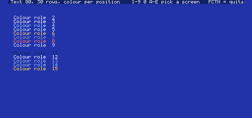

**Text 80** (`VMT80`) is 80 columns of 6 x 8 glyphs. With `VOPOS` every position has an attribute byte (high nibble foreground, low nibble background: palette entries 0-15, which are the
kernel's colour *roles*, so a colour scheme recolours the whole screen). Without it all text takes the foreground and background in VR7 (`RTEXT` on `RBG`) and the attributes you pass are
ignored. This is the mode Press and the SAMS Kernel's boot use. 24 rows (1,920 cells) or 30 (2,400).

| Without `VOPOS`, 24 rows | Text 40, 30 rows, with `VOPOS` |
| --- | --- |
| 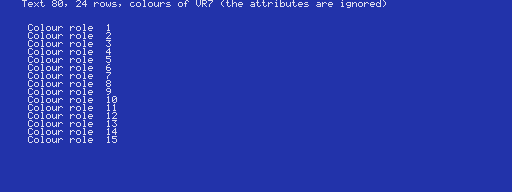 | 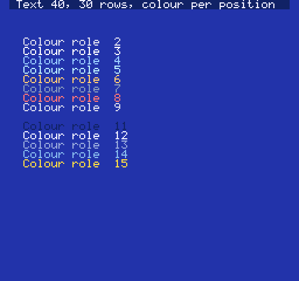 |

**Text 40** is the same with 40 columns, so text and the glyphs look twice the size; the screen has an 8-pixel margin each side that shows the backdrop.

**Graphics I** (`VMGM1`) is 32 x 24 (or 30) tiles of 8 x 8 pixels, the glyph's full 8 columns. The colour comes from the 32-byte colour table at `GM1CT`: one byte (foreground nibble,
background nibble) for each group of 8 consecutive pattern numbers. `VMODE` fills it with `RTEXT` on `RBG`, the same as the other modes; the demo gives each group a colour of its own:

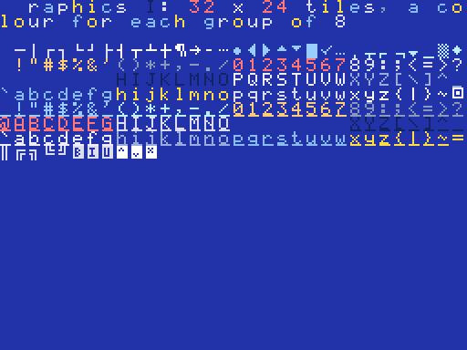

With enhanced colour (`VOTE1-3`) Graphics I uses an attribute table instead (part 5), per tile *code* or, with `VOPOS`, per screen position.

The text routines (`PUTS`, `PUTC`, `FILLN`, `FILLA`, `DECW`, `HEX2`, `HEX4`, `CLS`, `BOX`, `VSHIFT`) work in these three modes and follow `TXCOLS`/`TXROWS`. In a mode
with no attribute table (`TXATTR` = 0) they skip the attribute: pass any value.

## 5. Enhanced colour for tiles (VOTE1, VOTE2, VOTE3)

Normal colour gives a tile pixel one of two colours. In an enhanced colour mode each tile pixel takes **1, 2 or 3 bits** from that many pattern **planes** (the pattern table, plus
`>800` and `>1000` further on) and the result, 0 to 1, 3 or 7, selects an entry of a palette *set* chosen by the tile's **attribute byte**:

| Attribute bit | Meaning |
| --- | --- |
| 7 (`>80`) | priority: the tile draws over sprites |
| 6 (`>40`) | flip horizontally |
| 5 (`>20`) | flip vertically |
| 4 (`>10`) | colour 0 transparent (the layer or backdrop behind shows through) |
| 3-0 | the palette select |

| Mode | Planes | Colours | Palette entries used |
| --- | --- | --- | --- |
| `VOTE1` | 1 | 2 | `(attribute AND >F) * 2`, and +1: sixteen pairs (entries 0-31; VR24's bit 1 adds 32) |
| `VOTE2` | 2 | 4 | `(attribute AND >F) * 4` plus the pixel value: sixteen sets of 4 (0-63) |
| `VOTE3` | 3 | 8 | `(attribute AND >E) * 4` plus the pixel value: eight sets of 8 (0-63; bit 0 ignored) |

So in `VOTE3` the attribute `2` picks entries 8-15, `4` picks 16-23 and so on. **The attribute is per tile *code*** (a table of 256 bytes at the colour-table address) unless you add `VOPOS`, when it
is **per screen position** (the table at `ATRTAB` that Text 80 uses): `VOPOS` is almost always what you want, and it is what the text routines write (`PUTS`'s attribute argument).

`VMODE` sets the default attribute to 0, loads the scheme into entries 0-15, and for enhanced colour makes **entry 1 the text colour** (it copies the scheme's entry 2 over it), so that a one-plane glyph (pixel
1 = entry 1) shows as text on the page (pixel 0 = entry 0, the scheme's background). Everything else about the palette is yours: load what you need with `F18PAL` (part 9) after `VMODE`.
`SETSCH` re-applies the tweak, and rewrites entries 0-15 only.

The glyph set only has plane 0, so ordinary text in an enhanced colour mode is the two colours of pixel 0 and pixel 1. To draw a multi-plane tile, write its planes yourself:

```
       LI   R0,PATTAB+8           glyph 1, plane 0 ...
       LI   R1,>AA00
       LI   R2,8
       BL   @VFILL
       LI   R0,PATTAB+>800+8      ... plane 1 ...
       LI   R1,>CC00
       LI   R2,8
       BL   @VFILL
       LI   R0,PATTAB+>1000+8     ... plane 2
       LI   R1,>F000
       LI   R2,8
       BL   @VFILL                every row: the pixels count 7 6 5 4 3 2 1 0 across the tile
```

| Enhanced colour 1, Text 80 | Enhanced colour 2, Text 40 | Enhanced colour 3, Graphics I |
| --- | --- | --- |
| 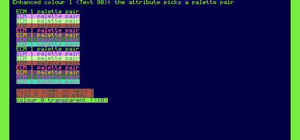 | 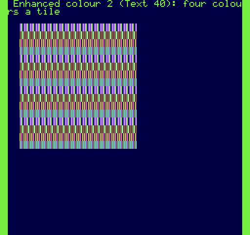 | 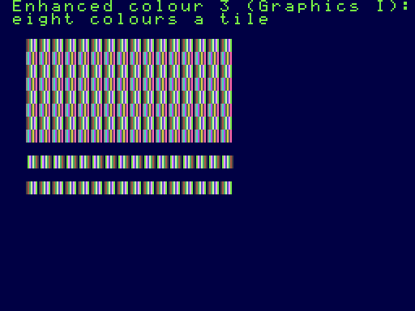 |

In the left screen each row is a different palette pair (the attribute's low nibble) and the last three rows are the same text with flip x, flip y and colour 0 transparent. In the middle, each row
is a tile of four colours in a different set of four; on the right, a tile of eight colours in eight different sets, then flipped in x. Text 80 and Text 40 tiles are 6 pixels wide (the left six columns of each pattern byte); Graphics I tiles are 8.

The attribute you hand to `PUTS`, `FILLA`, `CLS` and `BOX` is this byte in an enhanced colour mode: **do not pass a role attribute such as `(RTEXT*16+RBG)*256`**, whose bits 7-4 mean priority/flip/transparent here
(the demo's title bar learned this: it clears the attribute to 0).

## 6. Graphics II (bitmap) and Multicolor

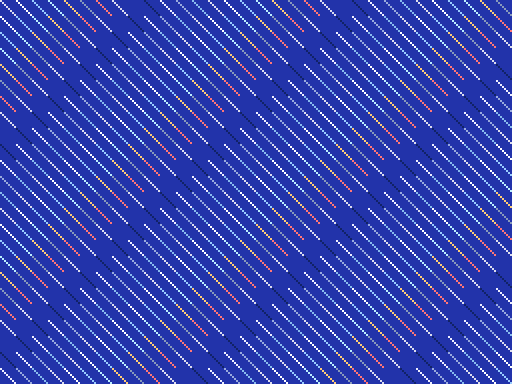

**Graphics II** (`VMGM2`) is a bitmap: 256 x 192 pixels in three vertical thirds of 64 rows. The name table has 768 cells, each a tile number. A tile's 8 pattern bytes (one per pixel row) and 8
colour bytes (foreground nibble, background nibble, one per pixel row, so each row of 8 pixels can have its own two colours) are looked up in the pattern and colour tables **in the third of the screen
the cell lies in**. `VMODE` fills the names with `0-255` three times over (the standard arrangement), so the cell at tile row `r`, column `c` (`r` = 0-23) is tile `(r AND 7) * 32 + c`, and the pixel at (x, y) is bit `7 - (x AND 7)` of

```
        GM2PT + (y>>6)*2048 + (((y>>3) AND 7)*32 + (x>>3))*8 + (y AND 7)
```

with its colours in the byte at the same offset from `GM2CT`. Write patterns and colours with `VMBW`/`VFILL`; the demo gives every tile a diagonal line and a colour of its own. The text routines are not for this mode
(the name table holds tile numbers, not text). 24 rows only; **do not use files while it is showing** (part 3).

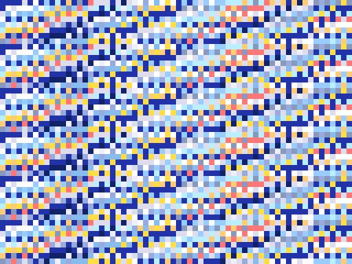

**Multicolor** (`VMMC`) is 64 x 48 "pixels" of 4 x 4. Each of the 32 x 24 name-table cells holds a pattern number `n`; the colours of that cell's four blocks are in the **eight bytes at `PATTAB + n*8`**: the cell is 2 blocks
wide and 2 high, and the table gives the colours for a row of blocks per byte: byte `k`'s high nibble is the left block and its low nibble the right, where `k = (cell row AND 3) * 2 + (0 for the top row of blocks, 1 for the bottom)`.
The pattern number therefore selects four *pairs of rows* at once, and the usual practice (the TMS9918A manual's) is to fill the name table with `(row AND 3) * 32 + column`, so that each of 128 patterns serves one
cell column in each group of four rows, and to fill the patterns with the picture; that is what the demo does, with invented colours. Colour 0 is transparent (the backdrop shows). 24 or 30 rows.

## 7. Sprites

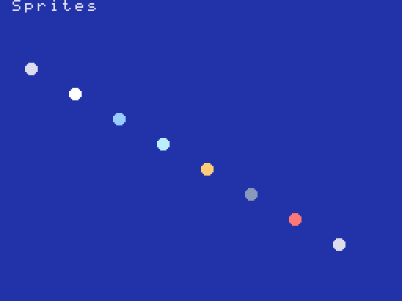

Up to 32 sprites, in every mode (in Text 80/40 only on an unlocked F18A, which the kernel always has). Turn them on with `VOSPR` (VR51 = 32); `VOS16` for 16 x 16, `VOSMG` to double the size.
Without `VOSPR` the stop-sprite register (VR51) is 0: nothing is drawn however the table reads. **Hide a sprite with VR51 or by moving it, not with the TMS9918A's `>D0` terminator**: with 30 rows the F18A ignores that terminator.

**Sprite attribute table** at `SATAB` (`GM2SAT` in Graphics II), 4 bytes per sprite, sprite 0 first (sprite 0 draws in front):

| Byte | Meaning |
| --- | --- |
| 0 | Y, one less than the screen row of its top line (the F18A can also use the true Y: VR49 bit 3) |
| 1 | X |
| 2 | pattern number (a multiple of 4 for a 16 x 16 sprite) |
| 3 | bits 3-0 colour (the palette select with enhanced colour); bit 7 early clock (X - 32); bit 6 flip x; bit 5 flip y; bit 4 force 16 x 16 for this sprite |

Sprite **patterns** are at `SPTAB` (`GM2SPT` in Graphics II): 8 bytes an 8 x 8 pattern, and a 16 x 16 sprite is four patterns in the order top-left, bottom-left, top-right, bottom-right. The kernel
spaces the extra planes of enhanced colour sprites `>200` apart (VR29), so each plane holds 64 patterns of 8 x 8, and the colour of a sprite pixel with
`VOSE1-3` is built exactly as for tiles: 1, 2 or 3 bits from the planes, the palette set from the **colour nibble of byte 3**:

| Mode | Palette entries used |
| --- | --- |
| normal | nibble = the sprite's colour: palette entry `nibble` (plus VR24's sprite select, bits 5-4) |
| `VOSE1` | `(VR24 AND >20) + nibble*2`, plus the pixel (0-1) |
| `VOSE2` | `nibble*4`, plus the pixel (0-3) |
| `VOSE3` | `(nibble AND >E)*4`, plus the pixel (0-7) |

Pixel value 0 is always transparent. The first screenshot above is eight 8 x 8 balls; this is the enhanced colour demo, four 16 x 16 sprites in colour sets 0, 2, 4 (flipped in x) and 6, then
sets 12, 10, 8 and 14:

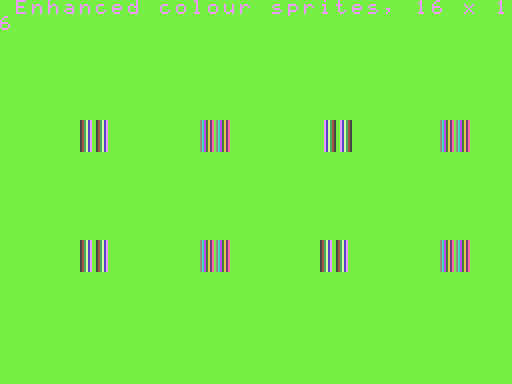

Sprite **linking** (VR49 bit 2: a sprite's position and early-clock bit are added to a parent's, set in the second half of the attribute table at `SATAB+>80`), the sprites-per-line limit (VR30: 0 = the
jumper, 4 or 32; 31 = all) and the stop sprite (VR51) are set with `VREG`; the demo does not use them.
Collision and "fifth sprite" flags are in status register 0 as on the TMS9918A (VR50 bit 3 makes the F18A report the maximum instead).

## 8. Tile layer 2, hardware scrolling, page sizes

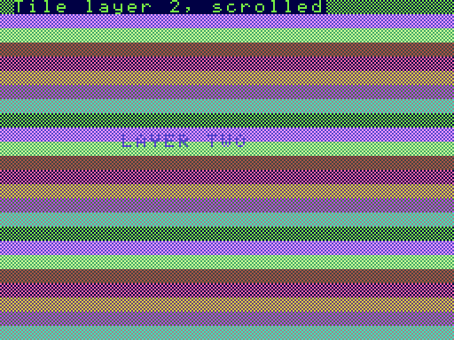

The F18A has **two tile layers**. Layer 1 is the screen `VMODE` sets up; layer 2 is a second screen with its own name table (`VR_NAME2`, 1K units) and colour/attribute table (`VR_COLR2`, 64-byte units),
the same pattern table, its own scroll registers and, with `VR49` bit 7, drawn *over* layer 1 (and over the sprites unless VR50 bit 0 is set). Where its pixels are transparent (an enhanced colour tile
with the attribute's bit 4 set, colour 0) layer 1 shows. The demo is Graphics I with enhanced colour 1: layer 1 is a coloured checker, layer 2 the words LAYER TWO on transparent tiles:

```
       LI   R0,VR_NAME2            layer 2's name table at >2000 (1K units)
       LI   R1,>0800
       BL   @VREG
       LI   R0,VR_COLR2            its attribute table at >2400 (64-byte units: >90)
       LI   R1,>9000
       BL   @VREG
       LI   R0,VR_ECM              tile layer 2 on, with tile ECM 1 as VMODE had set it
       LI   R1,>9000
       BL   @VREG
```

**Scrolling.** Each layer scrolls by pixel, independently: VR27 / VR28 (layer 1 horizontal / vertical), VR25 / VR26 (layer 2). In Text 80 the horizontal value counts the 256-pixel scale, so each unit moves 2 pixels of the 512-pixel-wide screen. The scrolling wraps at the edge of the screen (of the margin-less area, in the text modes). The **page size** bits of VR29 (bits 1 and 0 for layer 1,
bits 5 and 4 for layer 2) make the name table two pages wide and/or two high (the wrap then goes to the next page: `>400`/`>800` further for a horizontal/vertical page) so that a
map larger than the screen can scroll; set the layer's name table at the first of the pages.
VR50 bit 4 turns layer 1 off entirely.

## 9. Palette

The F18A has 64 palette entries of 12 bits (`>0RGB`). Entries 0-15 hold the kernel's roles; the power-up palette also fills 16-63 with variations. `F18PAL` loads entries:

```
       LI   R0,16                 the first entry
       LI   R1,MYPAL              a table of words >0RGB
       LI   R2,48                 how many
       BL   @F18PAL
```

VR24 selects which 16 (or 32, 64) entries each layer uses in the modes without their own selection: bits 1-0 for tile layer 1 (times 16), bits 3-2 for tile layer 2, bits 5-4 for sprites (normal mode).
In the normal colour modes colour 0 draws nothing (the backdrop, entry VR7's low nibble, shows through); in enhanced colour that is the attribute's bit 4.

## 10. The bitmap layer

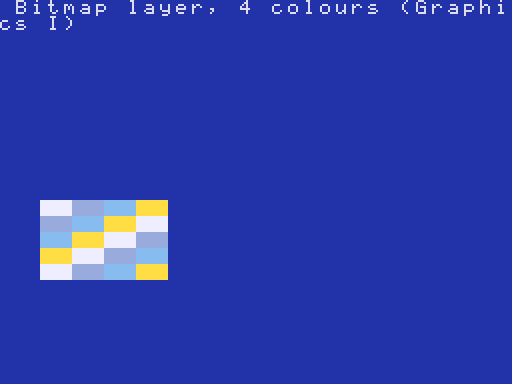

A rectangular bitmap, drawn over the tile layers (below the sprites and tile layer 2): its pixels take their colour from palette entries chosen by VR31, from 4 colours (2 bits a pixel) or, with
the "fat pixel" bit, 16 colours (4 bits a pixel, each pixel two columns wide).

| Register | Meaning |
| --- | --- |
| `VR_BMPCT` (31) | bit 7 on; bit 6 priority (draws over non-background tiles); bit 5 colour 0 transparent; bit 4 fat pixels; bits 3-0 palette select (x4 in 4-colour mode; bits 3-2 only, x16, in fat mode) |
| `VR_BMPAD` (32) | the bitmap's address in VRAM, in 64-byte units |
| `VR_BMPX`, `VR_BMPY` (33, 34) | the rectangle's top left |
| `VR_BMPW`, `VR_BMPH` (35, 36) | its width (0 = 256) and height in pixels |

The bitmap holds the pixels row by row, **4 pixels to a byte in both forms** (four 2-bit pixels, or two 4-bit pixels each two columns wide), so a rectangle of w x h pixels takes w x h / 4 bytes: 64 x 40 is 640 bytes.
Without the priority bit the layer shows only where the tile layer is the background colour. The demo's first screen above is a 64 x 40 four-colour bitmap with palette entries 12-15; the second is 16 colours:

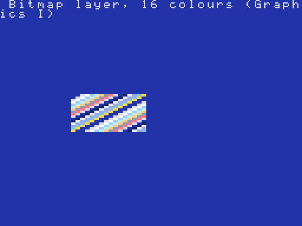

This is the way to put real graphics on a screen without giving up the file service (Graphics II uses the controller's VRAM). **The demo uses it over Graphics I.** In Text 80 the layer's position test is in 256-pixel units, but js99er's offset into the bitmap is
not halved to match, so it is unclear what the hardware does there; I did not use Text 80 for the demo, and you should check it on hardware before relying on it.

## 11. Other registers (set them with VREG)

| Register | Meaning |
| --- | --- |
| `VR_PALCT` (47) | palette data port mode (used by `F18PAL`); leave it |
| `VR_INCR` (48) | the VRAM address increment after each data port access (signed; 1 normally) |
| `VR_FLAGS` (50) | bit 7 reset all registers; bits 6, 5 GPU triggers on horizontal / vertical sync; bit 4 layer 1 off; bit 3 report the sprite maximum; bit 2 scan lines; bit 1 position attributes; bit 0 layer 2 vs sprite priority |
| `VR_HINT` (19) | the scan line of a horizontal interrupt (0 = off) |
| `VR_SPRMX` (30) | sprites per line |
| `VR_STOP` (51) | the stop sprite |
| `VR_GPUHI/LO`, `VR_GPUCT` (54-56) | the F18A's GPU: start address and control (the kernel uses it for `VSHIFT`; a program of your own should keep out of `GPUAD`) |
| `VR_STAT` (15) | the status register that reads next |

The F18A is also a 9918A-compatible: VR0-VR7 mean what they do on the 9918A, and an *unlocked* F18A (the kernel keeps it unlocked) accepts registers 8-63.

## 12. What `VMODE` does not cover, and what I did not check

- **Graphics II with 30 rows** is not offered (the pattern thirds do not cover rows 25-30); Multicolor with 30 rows is set but not drawn by the demo.
- **Text 80's bitmap layer** is untested (part 10). **Linking, horizontal interrupt, the scan lines, the GPU beyond `VSHIFT`, page sizes** are available through `VREG` but the kernel's tests do not exercise them.
- **The renderer is not the F18A.** It reproduces js99er's drawing, which I read and ported, and the demo's colours and positions are checked against it. A real F18A may differ in details; confirm each mode you rely on on the
  hardware (`examples/modes` is the program to run: keys `1-9 0 A-E`).
- **PAL and 50 Hz, the PICO9918:** the F18A registers above are those of the F18A. The kernel treats a PICO9918 as an F18A, but I did not test its modes.
- **Sound, joysticks** are not video.

## 13. Trying the modes

```
python3 tools/skbuild.py examples/modes                 build/modes/videomodes8.bin: load it in js99er (F18A, 512K SAMS)
python3 tools/f18render.py build/modes/videomodes8.bin shot.png "<WAIT 5>6<WAIT 20>" 900     key 6: Graphics II, drawn to shot.png
python3 tools/mkshots.py                                the fifteen images in docs/images
python3 tests/test_kernel.py modes modesquit            the pixel checks, and the register restore on quit
```

Keys in the demo: `1-4` the four text screens, `5` Graphics I, `6` Graphics II, `7` Multicolor, `8` `9` `0` the three enhanced colour levels, `A` `B` sprites, `C` tile layer 2, `D` `E` the bitmap layer; `FCTN =` quits.
In your own tests, `f18render.render(m)` returns the picture as a numpy array; `f18render.palette_rgb(m)` the 64 colours; compare a pixel with `pal[entry]`, as `tests/test_kernel.py` does.
